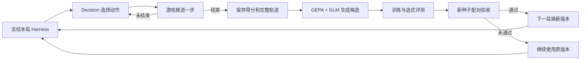

# Game Harness Lab · 贪吃蛇 V1

可运行的本地实验台：**StartLux Decision 全程玩贪吃蛇，GLM-5.3 初始化策略，每局结束后使用真实 GEPA 优化 Harness。**

首版只实现可暂停、逐步推进的贪吃蛇。俄罗斯方块、马里奥、实时游戏是后续扩展；`docs/architecture.md`、`contracts/` 和 `examples/` 保留最初的完整设计，不能视为已经实现的 SDK。

## 打开和启动

本机已安装依赖并配置模型，打开 **http://127.0.0.1:18765**。

服务未启动时：

```sh
cd /Users/biws01/Desktop/003_chat/game-harness-lab
./run.sh
```

新环境安装：

```sh
./setup.sh
# 在 .env 中填写自己的 COACH_API_KEY，其他参数参考 .env.example
./run.sh
```

页面点击「开始实验」。可设置棋盘、单局步数、训练/选优/发布场景数、反思轮数和连续游玩局数；支持暂停、继续、停止、回放和已批准版本之间切换。暂停或停止会等待当前网络请求返回，不再推进新的游戏步。

## 模型职责

| 环节 | 实现 |
| --- | --- |
| 所有局内动作，包括评测局 | 本地 `/v1/systemone`，固定 `startlux-decision-27b-autothink`；每次请求显式 `think_mode=never` |
| 首局前 | `glm-5.3` 生成背景、目标、规则、注意事项、攻略及初版 Harness |
| 正式游玩结束后 | GEPA 组织训练、反思和选优；GLM-5.3 生成候选 Harness |
| 执行动作 | 固定游戏引擎仅应用模型返回的上下左右；没有寻路器或备用玩家 |
| 决定是否发布 | 固定计分与新旧版本配对评测，不接受教练自报的“提升” |

服务默认思考模式可能仍显示 `auto`；本项目不修改已有模型服务配置，实际请求统一覆盖为 `never`。记录每步返回的模型名、思考遥测、概率、原始响应和前后状态。返回错误时停止该局，不用脚本接管，也不把基础设施故障当作策略零分。

## 每局发生什么



得分就是吃到的食物数；不奖励空转生存。每个正式游玩回合恰好对应一个持久化优化任务，评测回合不递归生成任务。第一次初始化可能自动修复一次 JSON 格式，仍不合规则明确报错。

V1 仅优化 `decision_instructions` 和 `strategy_notes` 两个文本字段，不能改规则、得分、动作集合或执行代码。GEPA 固定到 commit `f1cfdee2856e9dc4b5b4dc5cc2e391d0aa20d819`，全部 Python 依赖见 `requirements.lock`。

发布门槛是**至少 4 对新场景、平均增加至少 0.5 个食物、每对均不退步**；不足 4 对只能检查流程，不会发布。这个小样本门槛不能证明泛化提升，也不保证每轮进步。搜索的选优分数不能冒充独立成绩。

## 文件和验证

- [首版总结](docs/project-summary-v1.md)：目标、已交付能力、真实结果、已知限制与后续顺序。
- [V1 实现说明](docs/implementation-v1.md)：接口、数据、恢复机制和明确未实现的部分。
- [实测记录](docs/validation-v1.md)：真实模型联调与自动测试证据。
- [最初架构](docs/architecture.md)、[实施路线](docs/roadmap.md)。
- 源码：`src/game_harness/`；单元/集成测试：`tests/`。
- 本地实验数据：`data/registry.sqlite`、`data/episodes/`、`data/traces/`、`data/jobs/`、`data/versions/`。
- 密钥仅放在被忽略的 `.env`；页面、实验导出和日志不包含该密钥。

```sh
.venv/bin/python -m pytest -q
```

测试中的模拟模型只用于协议和故障检查，不属于应用的玩家，也不算真实模型成绩。

## 研究依据

[GEPA / JevHarness](docs/research-gepa-jev.md)、[Continual Harness / Voyager / OpenEvolve](docs/research-patterns.md)、[游戏环境](docs/research-games.md)。本实现自写游戏与调度器，没有复制许可证不明确的 JevHarness 代码。
