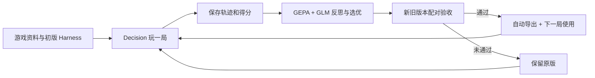

# Game Harness Lab

## 原神 Windows 体验版：hhr-yuanshen

直接体验：[下载安装程序](windows/StartLux-Genshin-0.2.0-preview-win-x64.exe)，在 GitHub 文件页点击 **Download raw file**。安装包包含桌面语音界面、离线中文语音模型、Agent 和 BetterGI，无需另装 Python 或 .NET。

本分支统一保存相关代码、BetterGI 改造补丁、[BetterGI 完整源码快照](windows/BetterGI-StartLux-source.zip)、安装包及 [Windows 验证结果](windows/windows-verification.json)。完整安装包和源码快照由 Git LFS 管理；使用 Git 克隆时：

```sh
git lfs install
git clone --branch hhr-yuanshen --single-branch https://github.com/dctongsheng/game-harness-lab.git
cd game-harness-lab
git lfs pull
```

Windows 中双击 `Try-Genshin.cmd`，校验安装包后启动安装。也可直接运行 `windows/StartLux-Genshin-0.2.0-preview-win-x64.exe`。浏览器下载源码 ZIP 后，可从上面的安装程序文件页单独获取完整安装包。[首次设置与试跑步骤](windows/README.md)。

当前为 Windows 11 22H2 及以上 x64 开发预览，先支持中文界面和蒙德委托。Windows 安装、启动、中文解码器与卸载已验证；原神实机闭环和真实麦克风仍待验收。首次运行需配置可用的 BetterGI 战斗策略，以及用户自己的榜首 StartLux 模型部署 ID / Key。

## 新工程：StartLux 通用执行平台

独立工程位于 [platform/](platform/README.md)，采用 **通用执行内核 + 场景插件 + Google Harness² 优化后端**。新客户端与后端均不依赖 RRSI，也不依赖下方保留的小游戏框架。

首批场景为原神每日任务和文件账目处理。Windows 客户端执行任务、保留观察与动作记录；Linux 后端调用官方 Harness² 改进文本策略，经过独立回归后管理版本与回滚。原神回放候选可导出到 Windows 开发试跑，实机结果仍须验证。插件接口、模型配置与完整操作见 [平台指南](platform/README.md)。

## 保留的小游戏实验

**通用游戏 Harness 进化框架：游戏适配器 + Decision 玩家 + GEPA 局后优化 + 验收后导出。** 当前支持贪吃蛇、中国象棋、军棋、五子棋、俄罗斯方块、原创平台跳跃、Overcooked-AI 双人厨房和宝可梦对战（poke-env）。

原有八款游戏实验的局内动作都由 StartLux Decision 选择，显式 `think_mode=never`、`allow_none=false`。GLM-5.3 负责游戏资料、策略设计、历史经验提取与局后反思。适配器负责规则、完整动作集和计分，运行器负责模型调用与执行校验。

## 启动

需要 Python 3.11+；中国象棋、军棋、五子棋、俄罗斯方块和平台跳跃的规则引擎需要 Node.js 18+。Overcooked 另用独立 Python 3.10 环境：主环境装好后运行 `bash scripts/setup_overcooked.sh`（需要 uv），不会更改主环境的 Python。宝可梦另需 Node.js 22.18+，运行 `bash scripts/setup_pokemon.sh` 安装固定 poke-env 和本地 Showdown。已在 macOS 验证；六款基础游戏的已打包引擎不需要 npm 安装。

```sh
./setup.sh
# 在 .env 配置自己的模型地址和 COACH_API_KEY；不要提交 .env
./run.sh
```

打开 **http://127.0.0.1:18765**，选择游戏，点击开始实验。支持暂停、继续、停止、历史回放、资料/策略对比以及已批准版本回滚。

宝可梦支持 Showdown 原版精灵动画观战。安装宝可梦环境后运行 `.venv/bin/python scripts/setup_showdown_viewer.py`，在实验台点击“原版动画观战”或打开同一服务的 `/spectate`。可实时看出招、换人和血量变化，支持暂停动画、倍速、重播与追到最新。所有游戏操作仍由 Decision 选择；精灵图片按需从官方资源站加载。[安装、入口和真实验收](docs/pokemon-showdown-spectator-v1.md)。

本机配置的玩家为 `http://127.0.0.1:18080/v1/systemone` / `startlux-decision-27b-autothink`，教练为 `glm-5.3`。需要认证时，在本地 `.env` 设置 `DECISION_API_KEY_FILE=~/.config/startlux-decision/api.key`；密钥只进入 HTTP Authorization，不进入模型 state、实验 manifest 或 Git。模型服务的全局思考默认值未改，每次玩家请求覆盖为 `never` 并验证遥测。

## 如何进化



每个正式回合创建一个优化任务，任务中的评测局不会递归优化。每局冻结策略；GEPA 只修改两个文本组件，不能改规则、分数、参考对手或执行器。GEPA 固定源码 commit，Python 依赖固定在 `requirements.lock`。

初始化时，LLM 会收到当前游戏的真实观察样本、动作语义和 Decision 能力合同：单步 choice、关闭思考、没有跨步会话记忆或搜索辅助。它先生成游戏资料和初始策略，再由真实对局检验；合同适配并不保证初版一定正确。模型、规则和合同哈希随版本保存。

局后反思默认使用 `complete_events_v1`：在预算内保留完整紧凑事件，优先提供终局、漏胜和循环等关键片段，明确哪些步骤被省略。军棋只包含候选方合法可见观察与公共后果。旧字符摘录 `legacy_excerpt_v1` 仅为可复现对照保留；两者不改变局内观察、动作集合或计分。

| 游戏 | 动作与得分 | 额外说明 |
| --- | --- | --- |
| 贪吃蛇 | 上下左右四方向始终提供；食物数为得分 | 不用寻路器或安全动作过滤代打 |
| 中国象棋 | 每步完整规则合法 ICCS 走法；双方均由 Decision 下棋 | 候选与固定参考策略对战；真实胜负与步数截断代理分明确区分 |
| 暗棋军棋 | 完整合法对局走法；真实胜/负/和为100/0/50 | 环境预置合法布阵，不优化布阵；候选、对手、教练与公共页面分开管理可见信息 |
| 五子棋 | 全部空位，9×9或15×15自由五子棋 | 真实胜/负/和100/0/50；种子交换候选黑白角色 |
| 俄罗斯方块 | 原生按键及100/300/1000ms持续时间 | 原生消行积分，保留重力/SRS/hold；不给存活加分 |
| 原创平台跳跃 | 原生左右/跳跃及按住时长 | 三个固定关卡，进度/金币/通关原生积分；不是原版超级马里奥 |
| 宝可梦 poke-env | 第三世代单打3v3，双方完整合法招式与换人均由 Decision 选择；原生胜/负/和100/0/50 | 双方秘密提交后结算；隐藏队伍不泄漏；预算截断不计分、不选优、不发布 |
| Overcooked-AI | 两名厨师均由 Decision 从六个原生动作选择；正确送餐才计原生分 | 两次选择同步推进一 tick；三张官方布局；独立 Python 3.10 规则进程，不用规划器 |

中国象棋参考 `decision-arena` 的规则集，使用固定 BSD 引擎。标准局面重复试验，种子奇偶交换候选执红黑；不同种子不代表不同开局。到步数上限只按固定子力差评分，不能当作获胜或胜率。

## Harness 保存在哪里

0.5.0 新增俄罗斯方块的实验性上下文组件：可独立启用结构化棋盘事实，以及由 Decision 自己更新的每块目标与短期动作记忆。四组对照命令及真实结果见 [V5 实验文档](docs/tetris-context-validation-v5.md)。这些选项通过实验运行器显式启用，网页常规运行默认关闭。LLM 可参与上下文整理；本轮在对局前完成历史经验提取并冻结，以隔离两个实验因素。

俄罗斯方块还可在实验运行器中附加当前棋盘 PNG：每次目标选择和按键均把图片送给 Decision，保留相同文字与完整动作目录。先安装可选依赖 `uv pip install --python .venv/bin/python '.[vision]'`。接入方式、配对对照及实际结果见 [V7 视觉输入验证](docs/tetris-vision-validation-v7.md)；网页常规模式不会自动启用实验配置。

V8 增加独立的 GLM 目标提示与完整 40 项条件落点后果：把消行、空洞和堆高写入目标选项描述。程序不筛选目标、不执行路径，每个实际按键仍由 Decision 决定。条件落点不代表按键路径可达；两组均保留视觉的 12 对真实对照中，均分由 0 提升到 708.33，新方案 12/12 局消行；详情见 [V8 落点规划验证](docs/tetris-landing-validation-v8.md)。

运行中的全部版本与轨迹位于本地 `data/`，不提交 Git。**通过配对验收的版本自动导出到：**

```text
harnesses/<游戏>/<版本>/
  manifest.json
  game.json
  strategy.json
  evaluation.json
  README.md
```

包包含游戏资料、固定规则与评分、策略、版本血缘、验收结果和文件哈希。未通过候选不会导出成批准版本。[查看已导出 Harness](harnesses/)。

`HARNESS_GIT_SYNC=1` 可在导出后自动提交该包并推送 `origin`，不暂存其他源码或用户改动；示例配置默认关闭。网络失败保留本地产物并标记待重试。详情见 [框架设计](docs/generic-framework-v2.md)。

## 原神实时控制开发分支

原神执行能力已迁入独立的 [StartLux Platform](platform/README.md)：通用执行内核、场景插件和 Google Harness² 优化后端。新运行时不再依赖旧游戏框架、GEPA 或 RRSI。原神的 Windows 执行器、语音界面和模型身份约束继续保留。

开发、模型配置、捕获记录导入、优化与候选任务包导出见 [platform/README.md](platform/README.md)。Linux 优化环境与 Windows 客户端分别安装。现有 `windows/` 安装包的实际版本以文件名和 `installer-source.json` 为准；新的源码不代表旧二进制已更新。
