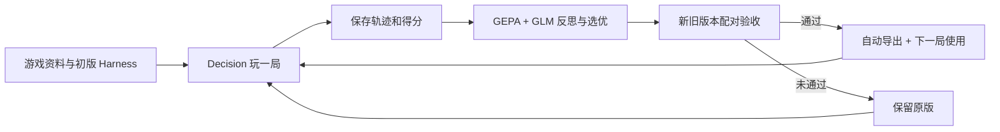

# Game Harness Lab

**通用游戏 Harness 进化框架：游戏适配器 + Decision 玩家 + GEPA 局后优化 + 验收后导出。** 当前支持贪吃蛇、中国象棋、军棋、五子棋、俄罗斯方块、原创平台跳跃、Overcooked-AI 双人厨房和宝可梦对战（poke-env）。

原有八款游戏实验的局内动作都由 StartLux Decision 选择，显式 `think_mode=never`、`allow_none=false`。GLM-5.3 负责游戏资料、策略设计、历史经验提取与局后反思。适配器负责规则、完整动作集和计分，运行器负责模型调用与执行校验。

## 启动

需要 Python 3.11+；中国象棋、军棋、五子棋、俄罗斯方块和平台跳跃的规则引擎需要 Node.js 18+。Overcooked 另用独立 Python 3.10 环境：主环境装好后运行 `bash scripts/setup_overcooked.sh`（需要 uv），不会更改主环境的 Python。宝可梦另需 Node.js 22.18+，运行 `bash scripts/setup_pokemon.sh` 安装固定 poke-env 和本地 Showdown。已在 macOS 验证；六款基础游戏的已打包引擎不需要 npm 安装。

```sh
./setup.sh
# 在 .env 配置自己的模型地址和 COACH_API_KEY；不要提交 .env
./run.sh
```

打开 **http://127.0.0.1:18765**，选择游戏，点击开始实验。支持暂停、继续、停止、历史回放、资料/策略对比以及已批准版本回滚。

宝可梦支持 Showdown 原版精灵动画观战。安装宝可梦环境后运行 `.venv/bin/python scripts/setup_showdown_viewer.py`，在实验台点击“原版动画观战”或打开同一服务的 `/spectate`。可实时看出招、换人和血量变化，支持暂停动画、倍速、重播与追到最新。所有游戏操作仍由 Decision 选择；精灵图片按需从官方资源站加载。[安装、入口和真实验收](docs/pokemon-showdown-spectator-v1.md)。

本机配置的玩家为 `http://127.0.0.1:18080/v1/systemone` / `startlux-decision-27b-autothink`，教练为 `glm-5.3`。需要认证时，在本地 `.env` 设置 `DECISION_API_KEY_FILE=~/.config/startlux-decision/api.key`；密钥只进入 HTTP Authorization，不进入模型 state、实验 manifest 或 Git。模型服务的全局思考默认值未改，每次玩家请求覆盖为 `never` 并验证遥测。

## 如何进化



每个正式回合创建一个优化任务，任务中的评测局不会递归优化。每局冻结策略；GEPA 只修改两个文本组件，不能改规则、分数、参考对手或执行器。GEPA 固定源码 commit，Python 依赖固定在 `requirements.lock`。

初始化时，LLM 会收到当前游戏的真实观察样本、动作语义和 Decision 能力合同：单步 choice、关闭思考、没有跨步会话记忆或搜索辅助。它先生成游戏资料和初始策略，再由真实对局检验；合同适配并不保证初版一定正确。模型、规则和合同哈希随版本保存。

局后反思默认使用 `complete_events_v1`：在预算内保留完整紧凑事件，优先提供终局、漏胜和循环等关键片段，明确哪些步骤被省略。军棋只包含候选方合法可见观察与公共后果。旧字符摘录 `legacy_excerpt_v1` 仅为可复现对照保留；两者不改变局内观察、动作集合或计分。

| 游戏 | 动作与得分 | 额外说明 |
| --- | --- | --- |
| 贪吃蛇 | 上下左右四方向始终提供；食物数为得分 | 不用寻路器或安全动作过滤代打 |
| 中国象棋 | 每步完整规则合法 ICCS 走法；双方均由 Decision 下棋 | 候选与固定参考策略对战；真实胜负与步数截断代理分明确区分 |
| 暗棋军棋 | 完整合法对局走法；真实胜/负/和为100/0/50 | 环境预置合法布阵，不优化布阵；候选、对手、教练与公共页面分开管理可见信息 |
| 五子棋 | 全部空位，9×9或15×15自由五子棋 | 真实胜/负/和100/0/50；种子交换候选黑白角色 |
| 俄罗斯方块 | 原生按键及100/300/1000ms持续时间 | 原生消行积分，保留重力/SRS/hold；不给存活加分 |
| 原创平台跳跃 | 原生左右/跳跃及按住时长 | 三个固定关卡，进度/金币/通关原生积分；不是原版超级马里奥 |
| 宝可梦 poke-env | 第三世代单打3v3，双方完整合法招式与换人均由 Decision 选择；原生胜/负/和100/0/50 | 双方秘密提交后结算；隐藏队伍不泄漏；预算截断不计分、不选优、不发布 |
| Overcooked-AI | 两名厨师均由 Decision 从六个原生动作选择；正确送餐才计原生分 | 两次选择同步推进一 tick；三张官方布局；独立 Python 3.10 规则进程，不用规划器 |

中国象棋参考 `decision-arena` 的规则集，使用固定 BSD 引擎。标准局面重复试验，种子奇偶交换候选执红黑；不同种子不代表不同开局。到步数上限只按固定子力差评分，不能当作获胜或胜率。

## Harness 保存在哪里

0.5.0 新增俄罗斯方块的实验性上下文组件：可独立启用结构化棋盘事实，以及由 Decision 自己更新的每块目标与短期动作记忆。四组对照命令及真实结果见 [V5 实验文档](docs/tetris-context-validation-v5.md)。这些选项通过实验运行器显式启用，网页常规运行默认关闭。LLM 可参与上下文整理；本轮在对局前完成历史经验提取并冻结，以隔离两个实验因素。

俄罗斯方块还可在实验运行器中附加当前棋盘 PNG：每次目标选择和按键均把图片送给 Decision，保留相同文字与完整动作目录。先安装可选依赖 `uv pip install --python .venv/bin/python '.[vision]'`。接入方式、配对对照及实际结果见 [V7 视觉输入验证](docs/tetris-vision-validation-v7.md)；网页常规模式不会自动启用实验配置。

V8 增加独立的 GLM 目标提示与完整 40 项条件落点后果：把消行、空洞和堆高写入目标选项描述。程序不筛选目标、不执行路径，每个实际按键仍由 Decision 决定。条件落点不代表按键路径可达；两组均保留视觉的 12 对真实对照中，均分由 0 提升到 708.33，新方案 12/12 局消行；详情见 [V8 落点规划验证](docs/tetris-landing-validation-v8.md)。

运行中的全部版本与轨迹位于本地 `data/`，不提交 Git。**通过配对验收的版本自动导出到：**

```text
harnesses/<游戏>/<版本>/
  manifest.json
  game.json
  strategy.json
  evaluation.json
  README.md
```

包包含游戏资料、固定规则与评分、策略、版本血缘、验收结果和文件哈希。未通过候选不会导出成批准版本。[查看已导出 Harness](harnesses/)。

`HARNESS_GIT_SYNC=1` 可在导出后自动提交该包并推送 `origin`，不暂存其他源码或用户改动；示例配置默认关闭。网络失败保留本地产物并标记待重试。详情见 [框架设计](docs/generic-framework-v2.md)。

## 原神实时控制开发分支

`game_harness.genshin` 新增独立的实时运行器、StartLux 图片决策、Windows 命名管道客户端、v2 开发任务包、每日奖励证据校验和 Google RRSI 快照评测适配器。StartLux 选择技能，BetterGI 执行连续移动和对话；动作粒度为 `skill`，请求允许弃选。截图帧可以持续变化，执行前重新核对账号、游戏日、控制代次和技能前置条件。停止使用独立控制管道，迟到响应不能重新获得控制。

安装开发依赖并验证合成样例：

```sh
uv pip install --python .venv/bin/python -e '.[test,vision,rrsi]'
.venv/bin/python -m game_harness.genshin validate-pack domains/genshin_snapshot/harness
.venv/bin/python -m game_harness.genshin snapshot \
  --pack domains/genshin_snapshot/harness --suite examples/genshin/synthetic-suite.json \
  --output data/genshin-snapshot.json --fixture-provider
```

合成样例仅验证接口与评分流程，不代表模型效果或原神实机成功。原生 Google RRSI 已固定源码版本；提交当前代码后可运行以下命令验证其 baseline/worktree 流程。实际搜索还需要配置 RRSI 的 Vertex 教练服务与真实 StartLux 模型任务包。

```sh
.venv/bin/python -m game_harness.genshin rrsi baseline \
  --suite examples/genshin/synthetic-suite.json --fixture-provider
```

Windows 执行桥接以固定 BetterGI 上游版本和私有补丁交付，可以复现到独立目录：

```sh
python scripts/setup_genshin_bridge.py --checkout .runtime/bettergi-agent
```

配置 `STARTLUX_AGENT_CONFIG` 指向本地 JSON，其中 `pack_directory` 是 Windows v2 任务包路径，`binding` 含 `account_id`（UID）、`server_id`、`server_utc_offset_minutes` 和 `region`。`STARTLUX_AGENT_PIPE` 默认 `startlux-genshin`。任务包必须标记 `environment=windows`，固定真实模型部署名，并要求输入技能的 `account_verified` 与 `foreground` 前置条件为 `true`。支持的原生技能为 `observe.capture`、`path.run`、`dialogue.select`；路线来自已校验哈希的包内资源，`verify_text` 用于独立的操作后画面检查。缺少验证时执行结果为 `unknown`，不报告委托或奖励成功。

```powershell
# 启动已编译 BetterGI 与截图器后，在同一权限级别的终端运行
python -m game_harness.genshin run --pack C:\agent\daily-pack --pipe startlux-genshin --trace C:\agent\runs\daily.jsonl
```

`GENSHIN_DECISION_URL` 默认 Bamboo `/v1/decisions`，密钥沿用 `DECISION_API_KEY_FILE`。客户端和执行器必须加载完全相同的任务包。快照 RRSI 冠军不能作为客户端发布版本。

Windows 桌面预览版位于 `desktop/`，支持本地中文语音“开始每日任务”“停止”和文字指令。安装包包含中文 Vosk 模型、Python Agent 和 BetterGI，用户无需另外安装 Python 或 .NET。当前支持 Windows 11 22H2 及以上 x64；游戏需要中文界面、蒙德委托以及可用的 BetterGI 战斗策略。首次设置填写游戏程序路径、UID、服务器、Bamboo Key 和排行榜第一模型的真实部署 ID；必须确认该部署对应 **StartLux Decision v1.1 27B Instant**，不会把 AutoThink 别名自动当作同一权重。密钥用当前用户 DPAPI 加密，经子进程 stdin 传递，不进入命令行、环境变量或轨迹。

每次运行从固定版本 AutoCommission 资源生成哈希校验的任务包，等待进入主界面并核对 UID 后才接管。Decision 在扫描、四个单项委托、每日领奖动作中选择。每项执行后重新打开冒险之证，逐项保存完成标记原始截图；状态不明、路线失败、任务未变为完成均停止。四项真实委托确认完成后才前往凯瑟琳，仅选择每日委托奖励，再用冒险之证“今日奖励已领取”核验。历练点不作为真实委托完成证据，未识别原石数量时保持 `null`。结果与截图保存在 `%LOCALAPPDATA%\StartLux\Genshin\runs`。

私有分支的 [Windows 工作流](https://github.com/dctongsheng/game-harness-lab/actions/workflows/genshin.yml) 构建 `StartLux-Genshin-Windows-preview` 安装包附件，并执行安装、独立运行时检查、中文模型原生解码检查、WPF 控件检查和卸载。附件保留 14 天。构建步骤：安装 `requirements-desktop.lock`，应用 BetterGI 固定补丁，运行 `python scripts/build_genshin_desktop.py --bettergi PATH`，最后用 Inno Setup 6 编译 `desktop/installer.iss`。

安装包为开发预览，尚无原神实机端到端成功证据；CI 没有原神或麦克风，不能证明委托成功率、语音识别准确率或原石到账。安装包随附 GPL 对应源码、补丁和第三方许可。每日领取实机验收仍需在用户 Windows 游戏环境完成。

跨语言 IPC 回归可设置 `GENSHIN_DOTNET` 和 `GENSHIN_BRIDGE_FIXTURE_DLL` 后运行 `tests/test_genshin.py`；没有 .NET fixture 时这一个测试会跳过。合成基线、快照评测和实时游戏轨迹分别标记，未知原石数量保持 `null`。

## 验证与文档

```sh
.venv/bin/python -m pytest -q
.venv/bin/python scripts/audit_saved_run.py
```

审计脚本根据保存的动作重放各游戏，核对完整候选目录、模型回执、思考模式、双方角色和最终得分，不再次调用模型。

- [V2 通用框架与新增游戏接口](docs/generic-framework-v2.md)
- [V2 实测结果](docs/validation-v2.md)
- [V3 四游戏适配与验证边界](docs/additional-games-v3.md)
- [六游戏 RSI 诊断与实验设计](docs/rsi-diagnosis-v1.md)
- [V4 完整反馈与真实对照实验](docs/feedback-validation-v4.md)
- [V5 俄罗斯方块结构事实与目标记忆](docs/tetris-context-validation-v5.md)
- [V6 俄罗斯方块按键控制、LLM 修订与配对实验](docs/tetris-control-validation-v6.md)
- [V7 俄罗斯方块视觉输入与配对实验](docs/tetris-vision-validation-v7.md)
- [V8 俄罗斯方块条件落点后果与独立目标规划](docs/tetris-landing-validation-v8.md)
- [宝可梦 poke-env 接入与真实实验](docs/pokemon-integration-v1.md)
- [Showdown 原版精灵动画观战与真实验收](docs/pokemon-showdown-spectator-v1.md)
- [Overcooked-AI 双人厨房接入与真实实验](docs/overcooked-integration-v1.md)
- [V1 总结](docs/project-summary-v1.md)、[V1 历史实测](docs/validation-v1.md)
- [原始长期架构提案](docs/architecture.md)、[路线图](docs/roadmap.md)
- [第三方来源与许可证](THIRD_PARTY_NOTICES.md)

`contracts/` 和 `examples/` 中的完整声明式配置仍是长期设计提案；当前可运行接口在 `games/base.py`。原版马里奥、真实时间持续推进控制和权重训练尚未实现。Overcooked 的真实回放、同步时间和计分显示已在浏览器验证；这不代表其余游戏的所有页面交互均已验收。
