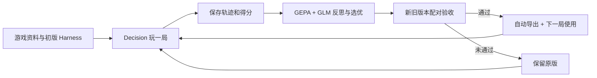

# Game Harness Lab

**通用游戏 Harness 进化框架：游戏适配器 + Decision 玩家 + GEPA 局后优化 + 验收后导出。** 当前支持贪吃蛇和中国象棋。

所有局内动作都由 StartLux Decision 选择，显式 `think_mode=never`、`allow_none=false`。GLM-5.3 只负责初始化游戏资料与局后反思。适配器负责规则、完整动作集和计分，运行器负责模型调用与执行校验。

## 启动

需要 Python 3.11+；中国象棋额外需要 Node.js 18+。已在 macOS 验证。

```sh
./setup.sh
# 在 .env 配置自己的模型地址和 COACH_API_KEY；不要提交 .env
./run.sh
```

打开 **http://127.0.0.1:18765**，选择「贪吃蛇」或「中国象棋」，点击开始实验。支持暂停、继续、停止、历史回放、资料/策略对比以及已批准版本回滚。

本机配置的玩家为 `http://127.0.0.1:18090/v1/systemone` / `startlux-decision-27b-autothink`，教练为 `glm-5.3`。模型服务的全局思考默认值未改，每次玩家请求覆盖为 `never` 并验证遥测。

## 如何进化



每个正式回合创建一个优化任务，任务中的评测局不会递归优化。每局冻结策略；GEPA 只修改两个文本组件，不能改规则、分数、参考对手或执行器。GEPA 固定源码 commit，Python 依赖固定在 `requirements.lock`。

| 游戏 | 动作与得分 | 额外说明 |
| --- | --- | --- |
| 贪吃蛇 | 上下左右四方向始终提供；食物数为得分 | 不用寻路器或安全动作过滤代打 |
| 中国象棋 | 每步完整规则合法 ICCS 走法；双方均由 Decision 下棋 | 候选与固定参考策略对战；真实胜负与步数截断代理分明确区分 |

中国象棋参考 `decision-arena` 的规则集，使用固定 BSD 引擎。标准局面重复试验，种子奇偶交换候选执红黑；不同种子不代表不同开局。到步数上限只按固定子力差评分，不能当作获胜或胜率。

## Harness 保存在哪里

运行中的全部版本与轨迹位于本地 `data/`，不提交 Git。**通过配对验收的版本自动导出到：**

```text
harnesses/<游戏>/<版本>/
  manifest.json
  game.json
  strategy.json
  evaluation.json
  README.md
```

包包含游戏资料、固定规则与评分、策略、版本血缘、验收结果和文件哈希。未通过候选不会导出成批准版本。[查看已导出 Harness](harnesses/)。

`HARNESS_GIT_SYNC=1` 可在导出后自动提交该包并推送 `origin`，不暂存其他源码或用户改动；示例配置默认关闭。网络失败保留本地产物并标记待重试。详情见 [框架设计](docs/generic-framework-v2.md)。

## 验证与文档

```sh
.venv/bin/python -m pytest -q
.venv/bin/python scripts/audit_saved_run.py
```

审计脚本根据保存的动作重放各游戏，核对完整候选目录、模型回执、思考模式、双方角色和最终得分，不再次调用模型。

- [V2 通用框架与新增游戏接口](docs/generic-framework-v2.md)
- [V2 实测结果](docs/validation-v2.md)
- [V1 总结](docs/project-summary-v1.md)、[V1 历史实测](docs/validation-v1.md)
- [原始长期架构提案](docs/architecture.md)、[路线图](docs/roadmap.md)
- [第三方来源与许可证](THIRD_PARTY_NOTICES.md)

`contracts/` 和 `examples/` 中的完整声明式配置仍是长期设计提案；当前可运行接口在 `games/base.py`。俄罗斯方块、马里奥、实时控制和权重训练尚未实现。浏览器视觉与点击交互仍未实际验收，已有前端语法、接口和后端真实模型测试。
