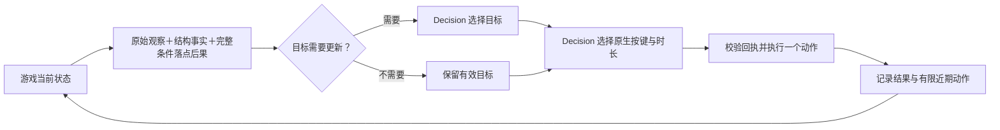

# 可进化组件与改进经验库 V1

这版把 Harness 从两段策略文字，扩展为可以分别修改的目标规划、有限记忆和观察组织。LLM 负责准备和局后修改，GEPA 组织候选搜索；**每次目标选择和游戏动作仍由 Decision 完成，显式关闭思考。** 是否升级，仍由独立新旧配对验收决定。

本文说明实现与使用方法，不报告能力提升。真实对照的预算、得分、消行与限制见 [俄罗斯方块组件化对照实验](tetris-components-experiment-v1.md)。

## 1. 当前支持范围

| 配置 | 可优化内容 | 当前支持 |
| --- | --- | --- |
| `text-v1` | `decision_instructions`、`strategy_notes` | 原有游戏适配器；保持旧版行为 |
| `tetris-components-v1` | 上述两项，以及目标、记忆、观察三个组件 | 俄罗斯方块 |
| 五组件＋经验库 | 五组件优化时，附带冻结的历史训练经验 | 俄罗斯方块；服务选项 `use_experience=true` |

网页选择俄罗斯方块后，提供“两段策略文字”“五组件”“五组件＋改进经验库”三个模式。其他游戏仍使用原来的两文本模式；五组件配置不能直接用于象棋、宝可梦或其他适配器。

**通用网页服务的五组件模式使用结构化文字输入，不会自动开启图片输入。** 本轮研究运行器单独使用 `VisionDecisionProvider`，所有实验组都固定附带当前棋盘 PNG。网页模式的成绩不能直接与这个视觉对照混算。

旧配置默认仍为 `harness_profile="text-v1"`、`use_experience=false`。旧版两文本候选、V1–V3 方块研究配置与原有版本命名空间继续兼容。新的五组件模式和经验开关使用独立服务命名空间，不会默默覆盖旧模式的当前版本。

## 2. 五个组件是什么

全部组件仍以字符串保存，单项最多 12,000 字符。没有可执行 Python、JavaScript 或动态插件。

| 字段 | 作用 | 可以修改的边界 |
| --- | --- | --- |
| `decision_instructions` | 本次原生按键选择的指导 | 指导文字 |
| `strategy_notes` | 游戏的策略重点与注意事项 | 策略文字 |
| `goal_instructions` | Decision 单独选择本块目标时的指导 | 目标规划文字；不改目标目录 |
| `memory_policy` | 如何使用有限目标记忆，以及更新频率 | 严格 JSON 字符串，字段见下文 |
| `observation_policy` | 如何阅读当前观察，以及观察区段的顺序 | 严格 JSON 字符串，字段见下文 |

`memory_policy` 解码后的结构：

```json
{
  "instructions": "结合自己选择的目标、目标年龄和近期实际操作，检查下一步是否仍合理。",
  "recent_actions": 4,
  "replan_every_actions": 4
}
```

- `recent_actions` 只能为 `2`、`4`、`8`：保留同一有效作用域中最近多少个实际动作。
- `replan_every_actions` 只能为 `2`、`4`、`8`：同一有效作用域中，间隔多少个游戏动作额外调用 Decision 重新选择目标。
- 新局、新方块（包括暂存换块）或锁定棋盘变化会使已有目标与近期动作记忆失效。
- 记忆内容来自 Decision 的目标选择和实际执行记录；LLM 不在局内填写目标或代选按键。

`observation_policy` 解码后的结构：

```json
{
  "instructions": "同时参考原始观察、结构事实、已有目标、控制结果和完整条件落点后果。",
  "section_order": [
    "observation",
    "tetris_features",
    "decision_goal_memory",
    "tetris_control_facts",
    "tetris_landing_projections"
  ]
}
```

`section_order` 必须是五个区段的完整排列，不能删除、重复或新增区段。这是**保留全部信息的重排与阅读指导**；V1 没有让 LLM 任意裁剪棋盘，也没有局内自由文本摘要器。

上述 JSON 是字段的内部结构。在 `strategy.json` 中，`memory_policy` 和 `observation_policy` 的值必须使用 `json.dumps(...)` 等方式编码成字符串，不能直接放嵌套对象。

## 3. 一局内怎样运行



每局先冻结整个 Harness。五组件映射到 `tetris-context-v4`，观察、记忆和目标调用都使用同一套经过验证的配置。

目标目录始终包含全部 40 个“列 × 朝向”组合，加上 `keep`、`clear`，共 42 项。程序为组合计算条件落点后果，例如消行、空洞和堆高；**这些是“假设先到达这个姿态”的几何结果，不证明原生按键路径可达。** 程序不按策略分数排序或筛掉目标，也不自动移动到目标位置。

随后另一次 Decision 调用，从完整原生动作目录中选择按键与时长。目标选择不能直接触发硬降、旋转或左右移动。每个调用都要求 `think_mode=never`；无效、空白或身份不匹配的回答会停止本次运行，不由规则机器人补动作。

因此可进化的是模型收到的指导、有限历史窗口、重规划频率与观察组织。游戏规则、计分、原生动作目录、40 项条件投影的计算、模型和执行校验均不在搜索范围内。记忆频率的改变可能增加目标调用次数，实验同时记录调用与耗时成本。

## 4. LLM 初始化与 GEPA 局后搜索

新建五组件服务模式时，LLM 收到固定游戏资料、真实初始观察样本、动作语义与五组件运行合同，生成：

- `brief`：背景、目标、规则、注意事项、策略解释；
- `candidate`：完整五字段候选。

初始化样本仅用于说明接口，不作为测试答案。五组件合同明确结构事实、条件投影和有限记忆实际存在，不再把增强模式错误描述成“没有任何跨步记忆或辅助信息”。

每局正式游玩结束后，GEPA 使用触发局与训练局的紧凑完整事件反馈，让 LLM 提议候选，再通过训练与选优场景比较。它接收两个新增参数：

```python
outcome = evolve_harness(
    # 其余参数：冻结候选、触发局、训练/选优种子、真实运行器、教练与作业目录
    ...,
    mutable_components=["decision_instructions", "strategy_notes"],
    improvement_experiences=frozen_entries,
)
```

`mutable_components` 默认包含当前候选的全部字段。指定白名单时，候选仍须保留完整字段，白名单外组件必须保持不变。非法 JSON、漏字段、越界的记忆频率或改动冻结字段都会拒绝该提案，保留父候选。

这使研究对照可以让各组共享同一个五组件初版：A 组只允许改两段文字，B/C 组允许改全部五项。**研究中的 A 组仍拥有冻结的目标、记忆和观察组件；它不等于网页的原始两字段模式。**

作业会保存组件名单、可变名单、实际运行合同、反馈和经验快照哈希。GEPA 返回的结果始终标记 `promotion="not_performed"`，搜索选中不等于通过发布验收。

## 5. 改进经验库保存什么

经验记录“遇到什么问题、尝试什么修改、观察到什么变化”，供后续局后反思参考。它不是额外游戏动作策略，也不是未经检验的成功定律。

每条记录包括：

- 适用现象 `cue` 与条件性建议 `lesson`；
- 修改的组件 `changed_components`；
- 真实训练／探针对局 ID、候选哈希、完整原始对局的哈希及配对得分；
- 程序算出的差值、结果分类和样本限制；
- 游戏、规则版本、运行配置类型、模型组成的隔离范围。

入库只接受明确标记为 `search_train` 或 `experience_probe` 的配对，检查相同种子、配置、游戏资料，以及实际运行时的候选哈希、最终分数和 Decision 关闭思考回执。LLM 只能提炼说明文字；不能提交或改写分数。

结果分类是样本内描述：

| 分类 | 程序条件 | 含义 |
| --- | --- | --- |
| `supported` | 平均差值为正，且没有配对退步 | 这些训练样本支持继续尝试该方向 |
| `regressed` | 平均差值为负 | 保存退步经验，供避免或重新审视 |
| `inconclusive` | 其他情况，包括持平或有正有负且均值非负 | 不能确认稳定收益 |

这不是显著性检验。多项组件共同变化时，记录 `confounded=true`，不能把收益归给某一个组件。

如果候选没有变化、没有完整可比训练对局，或者教练认为不能提炼可靠建议，可以没有条目；教练返回 `{"status":"NO_ENTRY"}` 时不入库。负经验和不确定经验可以保留，不只挑成功样本。

检索只读取相同隔离范围的旧条目，排除本轮训练、选优与验收种子，冻结读取的截止序号。最多 3 条、合计最多 8,000 字符；文件与索引均校验内容哈希。验证、正式比较和发布验收的得分或轨迹不作为下一轮经验提炼输入。普通服务保存到 `data/improvement-experiences/`；研究运行器使用实验目录内的独立库。

## 6. 独立验收与导出

普通服务沿用独立配对门槛：搜索完成后，用本次搜索未见过的种子分别运行父版与候选。至少 4 对，平均增益达到游戏规定门槛，且每一对都不退步，才升级。俄罗斯方块当前门槛为平均增加 100 原生积分。这是经验性小样本门槛，不代表长期泛化保证。

通过后，下一局使用新版本，并自动导出：

```text
harnesses/<游戏>/<版本>/
  manifest.json
  game.json
  strategy.json
  evaluation.json
  README.md
```

五组件包在 manifest 中额外保存 `runtime_profile`、`runtime_context` 和组件名单。`input_mode` 同时保留验收时使用结构化文字还是结构化文字加图片；带视觉版本的成绩不能直接套用于不提供图片的运行器。读回时验证其与 `strategy.json` 一致。未通过候选不会伪装成批准包。设置 `HARNESS_GIT_SYNC=1` 后，普通服务可自动提交并推送这个导出包；默认关闭，不会自动暂存其他源码。

**研究运行器与普通服务分开。** 它在 `data/experiments/<实验ID>/approved_harnesses/` 中隔离导出通过验收的版本，不写生产注册表，不激活当前网页版本。正式组间比较和发布验收分开运行；不会根据正式比较结果再修改策略。

## 7. 使用方法

以下命令均从仓库根目录执行。模型地址与密钥通过本地 `.env` / 密钥文件配置，不写入文档或 Git。

### 普通实验台

```sh
# 首次安装才需要执行
./setup.sh

# 已有服务运行时直接使用已有页面，不要重复启动
./run.sh
```

打开 `http://127.0.0.1:18765/`，选择俄罗斯方块及 Harness 模式。也可调用现有本地 API：

```sh
curl --noproxy 127.0.0.1 http://127.0.0.1:18765/api/run \
  -H 'Content-Type: application/json' \
  -d '{
    "game_id": "tetris",
    "harness_profile": "tetris-components-v1",
    "use_experience": true,
    "episodes": 1,
    "max_steps": 80,
    "train_games": 2,
    "validation_games": 2,
    "promotion_games": 4,
    "reflection_rounds": 1,
    "seed": 42
  }'
```

该请求会运行真实模型与游戏，并产生相应调用成本；它启动普通服务流程，不是预登记的组间研究对照。第一次运行经验库可以为空；后续是否产生条目取决于真实训练证据与提炼结果。

### 预登记研究运行器

视觉依赖尚未安装时，按项目使用的环境安装：

```sh
uv pip install --python .venv/bin/python '.[vision]'
```

每轮使用新的实验 ID。`prepare` 只冻结计划、代码哈希和父版，不调用模型；默认父版是已保存的 V8 研究 Harness，经五组件迁移形成共同父版，不是重新跑 GLM 初始化。

```sh
.venv/bin/python scripts/run_component_experiment.py prepare --id tetris-components-my-run
.venv/bin/python scripts/run_component_experiment.py run-develop --id tetris-components-my-run
.venv/bin/python scripts/run_component_experiment.py run-evaluation --id tetris-components-my-run
.venv/bin/python scripts/run_component_experiment.py run-promotion --id tetris-components-my-run
.venv/bin/python scripts/run_component_experiment.py report --id tetris-components-my-run
```

各阶段职责：

1. `prepare`：固定共同父版、代码／依赖、各阶段互不重叠的种子、预算和判定规则。
2. `run-develop`：先用独立 bootstrap 的训练配对建立冻结经验快照，再对三个条件各运行一次 GEPA。各组完成后冻结候选。
3. `run-evaluation`：8 个新种子，每种子运行三个冻结组，比较“五组件 − 两文本优化”和“带经验 − 不带经验”。
4. `run-promotion`：另外 4 个新种子，各组分别与共同父版配对验收；通过则隔离导出。
5. `report`：不调用模型；读取原始归档、核验请求与图片、重放原生动作并计算结果。

各组固定每局最多 80 个原生动作，目标调用另计；全部使用相同模型、关闭思考并附带视觉。经验 bootstrap 的额外对局与教练调用单独计成本。若经验快照为 `NO_ENTRY`，报告必须说明 C 组未获得有效经验，不能据此宣称检索产生了收益。

未完成操作会保留失败证据并停止。问题确认后，可对对应运行阶段加 `--retry-failed` 进行有记录的重试；不要删掉失败记录重新挑选成绩。已完成的相同逻辑操作用于恢复，不会跨实验组复用得分。冻结后源码或关键配置变化会拒绝继续，需新建实验 ID。

## 8. 实现入口与限制

- [组件校验与运行合同](../src/game_harness/components.py)
- [方块目标与上下文运行时](../src/game_harness/tetris_context.py)
- [GEPA 搜索与反馈边界](../src/game_harness/evolution.py)
- [经验库与数值证据绑定](../src/game_harness/experience.py)
- [服务验收与版本管理](../src/game_harness/service.py)
- [导出包完整性检查](../src/game_harness/exporting.py)
- [真实对照运行器](../scripts/run_component_experiment.py)与[独立归档报告](../scripts/report_component_experiment.py)

V1 没有训练模型权重，没有允许优化器修改规则或计分，没有把五组件自动推广到所有游戏，也没有保证每轮都提升。结构性组件的搜索空间仍受明确合同限制；是否值得继续扩大范围，以真实对照与独立验收为依据。
