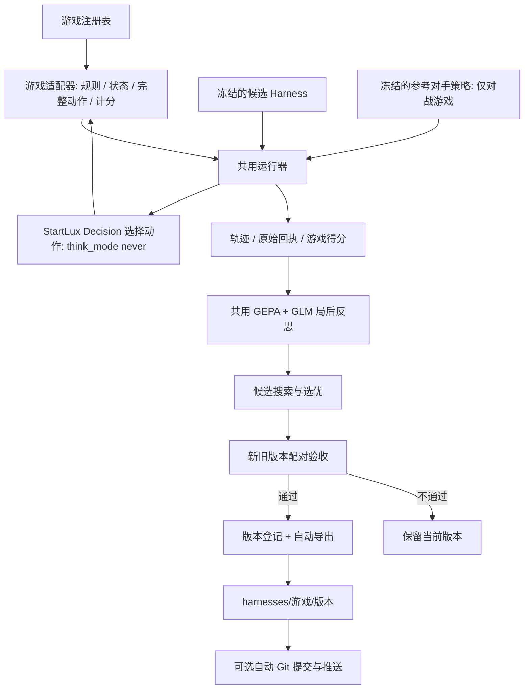

# 通用游戏 Harness 进化框架 V2

更新日期：2026-10-17。当前已接入贪吃蛇和中国象棋，两者使用同一套模型调用、轨迹记录、GEPA、验收与导出流程。

## 模块边界



| 模块 | 职责 |
| --- | --- |
| `games/base.py` | GameAdapter / GameSession 协议 |
| `games/__init__.py` | 注册游戏、列出游戏、按 ID 获取适配器 |
| `games/snake.py` | 包装原始蛇引擎；四方向全集、食物得分 |
| `games/xiangqi.py`、`xiangqi_bridge.cjs` | 中国象棋局面、规则合法走法、固定对手策略和固定评分 |
| `runtime.py` | 冻结策略、轮流调用 Decision、校验动态动作目录、机械执行和记录 |
| `providers.py` | Decision typed API 与局前/局后教练；不包含具体游戏提示模板 |
| `evolution.py` | 根据适配器上下文运行真实 GEPA；支持有限浮点评分及负分 |
| `service.py` | 实验调度、场景清单、配对门槛、版本管理与导出协调 |
| `exporting.py` | 五文件包、摘要校验、原子写入、定向 Git 同步 |

局内没有 LLM 代打、搜索引擎代打或随机兜底。对战游戏的双方都调用同一个 Decision 服务：一方使用正在进化的 Harness，另一方使用适配器声明的冻结参考策略。进化器不能改参考对手、规则、分数或动作目录。

Decision 请求及问题两层都显式设置 `allow_none=false`，要求从当前完整动作集中选择。服务仍返回空动作或无效概率时，本局以基础设施错误停止；不从概率表自行取最大项，也不计为游戏失败分。所有请求保持 `think_mode=never`。

## 适配器契约与新增游戏

适配器提供 `id`、`name`、`rules_version`、`rules`、`score_spec`、`defaults`、`opponent_policy`，以及：

```python
adapter.validate_config(config)       # 参数校验
adapter.scope_config(config)          # 影响适用范围的固定配置
adapter.context(config)               # 游戏、规则、评分、对手与场景说明
session = adapter.create(seed, config)
session.snapshot()                   # JSON: game_id, step, score, done, reason, policy_role 等
session.candidates()                 # 当前完整动作集 [{"id": "...", "label": "..."}]
session.step(action_id)               # 执行已选动作并返回下一状态；不能自行选择
session.close()                       # 释放规则进程等资源
```

`policy_role` 是 `candidate` 或 `opponent`。对手轮次只读取 `adapter.opponent_policy`，候选文本没有覆盖它的路径。每步保存当前完整动作目录和哈希，不能用上一回合的合法走法执行下一回合。

新增游戏实现以上协议后，用 `register_game(adapter)` 注册即可接入共用运行器和进化器。游戏特有参数可通过 `adapter.defaults` 声明，由 `validate_config` 校验，再由 `scope_config` 纳入版本范围。核心计分接口统一为“越高越好”，需要最小化损失的游戏应在适配器中明确转换。网页目前内置蛇和象棋两种渲染器；新游戏还需自己的可视化展示。

合法动作的含义由冻结规则决定。蛇允许撞墙方向，所以四个方向一直存在；象棋规则禁止非法走法，因此候选是全部规则合法走法。两者都没有按战术优劣剪枝。

## 版本范围与旧数据

新 `scope` 由游戏上下文、规则、评分、配置、对手策略、模型名称、接口与思考模式共同计算。不同游戏、不同预算或不同参考对手不会混用批准结果。

历史 V1 Snake 的文件和数据库记录保留。已通过配对验收的旧版本可以补导出；但旧范围标识和新适配器范围不同，新框架同参数首次运行会重新初始化并验证，不把旧批准直接冒充新范围批准。旧记录仍可回放，审计脚本专门兼容 V1。

## 中国象棋的具体实现

规则引擎参考用户提供的 `decision-arena`，使用它固定的 BSD-2-Clause `xiangqi.js` 源码；原文件未修改，保留版权和完整许可证，详见 `THIRD_PARTY_NOTICES.md`。没有修改参考项目。

- 标准 9×10 棋盘，红先黑后。规则覆盖马腿、象眼、九宫、炮架、过河兵、将帅照面和应将。
- 将死或困毙为胜；三次同局面、连续 120 半回合无吃子、仅剩将帅士象为和。未实现赛事长将长捉责任裁定。
- 每局一个常驻 Node 规则进程，JSON IPC 有序号、超时和响应大小限制；进程错误中止，不代走。
- 标准开局完整合法动作数为 44；ICCS 如 `h2h9`。每走一步重新获取当前完整合法动作。
- 种子奇偶决定候选执红或黑。训练、选优和发布尽量按奇偶分层，默认 4 对发布试验红黑各 2 对。
- 不同种子仍然是同一个标准开局的重复试验，并非不同棋盘或独立开局测试。
- 实际胜/负/和分别记 100/0/50。达到 `max_steps` 半回合上限时明确 `truncated=true`、`result=null`，按 `50 + clip(己方子力−对方子力, -40, 40)` 给代理分。
- 子力固定为车 9、马炮 4、士象 2、兵卒 1、将帅 0。这个评分只用于评测，不参与选动作或过滤候选；代理分不能当作胜率。

Node 18+ 是象棋额外依赖。当前进程控制在 macOS/POSIX 验证；Windows 的管道与文件锁仍需兼容工作。

## 自动导出的 Harness 包

仅当配对门槛通过、数据库已登记 `promoted` 后导出。初始化版本、未通过候选、仅在 GEPA 选优中领先的候选均不会被包装成批准产物。

```text
harnesses/
  snake/<version-id>/
  xiangqi/<version-id>/
    manifest.json     # schema、版本、父版本、范围、模型与文件 SHA-256
    game.json         # 固定规则、评分、配置、对手策略与初始化资料 brief
    strategy.json     # decision_instructions + strategy_notes
    evaluation.json   # 配对分数、场景/试验编号、原始回合 ID、门槛和搜索摘要
    README.md         # 人可读说明
```

包内容不可覆盖；相同版本重复导出会先校验已有包。文件缺失、篡改、额外文件或符号链接均被拒绝。通过临时目录再原子改名发布，进程重启会为已批准但尚未导出的版本补导出。

导出只保存可复用元数据和评测汇总，不含模型密钥、传输配置、原始 API 响应、私人绝对路径或完整运行轨迹。全轨迹继续留在忽略的 `data/`。这是策略配置包，需兼容适配器和 Decision 模型运行，不包含模型权重。

## Git 同步

`.env` 的 `HARNESS_GIT_SYNC=1` 开启验收后自动同步；示例配置默认 `0`，克隆者需自行启用并配置 GitHub 身份。

启用后，只暂存并提交当前 `harnesses/<game>/<version>/` 的五个文件，保留其他已暂存或未提交工作；然后推送当前分支到 `origin`。代码本身不会被该自动任务暂存。验收记录的发布不因 Git 网络故障回滚：导出仍在本地，`exports[].git.status` 标为 `pending`，服务重启或 `POST /api/exports/reconcile` 可以重试。

Git 推送仍遵循仓库分支权限和远端保护规则。这个机制不等同于 GitHub Actions、后台定时任务或模型自动修改仓库源码。

## API 与验收界限

新增 `GET /api/games`，`POST /api/run` 接收 `game_id`，`GET /api/harnesses/{game}/{version}` 返回校验后的导出包，`POST /api/exports/reconcile` 重试导出/同步。已有暂停、继续、停止和回放接口保留。

蛇的发布门槛仍为至少 4 对、平均 +0.5 食物、每对不退步；象棋为至少 4 对、平均 +2 分、每对不退步。都是小样本经验门槛，不是统计显著性或泛化证明。后台串行执行，本次未增加并发搜索、读屏或实时游戏控制。

测试记录与限制见 `validation-v2.md`。浏览器权限此前拒绝打开本地页面，当前前端只做静态与接口检查，未宣称完成视觉点击验收。
