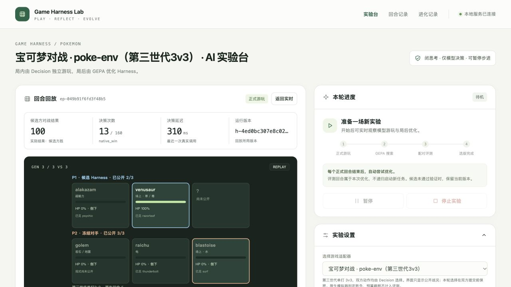

# 宝可梦对战 poke-env 接入 v1

本版把宝可梦对战接入共用游戏 Harness 进化框架。首版范围为**第三世代单打 3v3**：双方全部合法招式和换人均由 StartLux Decision 选择，思考关闭；GLM-5.3 在局前生成游戏资料与初始 Harness，在局后根据合法可见反馈修改策略，GEPA 组织搜索和选优。

## 环境和范围

使用官方 [poke-env](https://github.com/hsahovic/poke-env/tree/7ff6212e4e738efd46f1ea52035b37a8bba1e386) 0.16.1 与 [Pokémon Showdown](https://github.com/smogon/pokemon-showdown/tree/7244fe8e28fa8bc4d0809ae30d183c608b62bb2b) 的原生模拟器，均为 MIT。固定提交分别为 `7ff6212e4e738efd46f1ea52035b37a8bba1e386` 和 `7244fe8e28fa8bc4d0809ae30d183c608b62bb2b`。

本地同步调用 Showdown `Battle.choose()`，使用 `extractChannelMessages` 分离双方协议，再由各自的 poke-env `Battle` 解析观察。**没有连接公开匹配服，没有创建账号，不调用 poke-env Player 的自动选招或异常兜底。** 安装及启动不需要商业游戏本体或 ROM。

依据上游 [模拟器接口](https://github.com/smogon/pokemon-showdown/blob/7244fe8e28fa8bc4d0809ae30d183c608b62bb2b/sim/SIMULATOR.md)、[选择协议](https://github.com/smogon/pokemon-showdown/blob/7244fe8e28fa8bc4d0809ae30d183c608b62bb2b/sim/SIM-PROTOCOL.md) 与 [poke-env Battle 实现](https://github.com/hsahovic/poke-env/blob/7ff6212e4e738efd46f1ea52035b37a8bba1e386/src/poke_env/battle/battle.py) 接入。使用 Gen3 custom game 格式，但明确关闭原生 debug，限制 3 只、50 级、每只 4 招、无队伍预览，保留对手 HP 百分比隐藏规则。

环境从六种固定宝可梦池生成双方互不重叠的三只队伍。种子确定队伍、出场顺序和原生随机序列，奇偶决定候选席位。初始第一只出场由环境确定；本轮不优化选队。不含现代太晶化、Mega、极巨化、Z 招式，也不代表天梯完整规则或跨世代泛化。

## 层次与边界

| 文件 | 职责 |
|---|---|
| `games/pokemon.py` | 游戏合同、poke-env 私有/公共观察、完整合法动作目录 |
| `games/pokemon_bridge.cjs` | 固定 Showdown 原生规则、双方秘密提交屏障、真实胜负 |
| `runtime.py` | Decision 请求与回执绑定、合法选择校验后执行 |
| `initialization_contract.py` | 将实际字段和动作语义交给 LLM，明确不存在的工具/记忆 |
| `feedback.py` | 候选自身可见轨迹和公共结算的紧凑反思证据 |
| `scoring.py`、`service.py`、`evolution.py` | 原生结果资格检查、GEPA 搜索与配对验收 |
| `scripts/run_pokemon.py` | 固定预算真实实验，记录 HTTP 请求和原始响应 |
| `scripts/audit_pokemon_run.py` | 不调用模型，逐步重新运行原生规则并验证回执与分数 |

每次提供全部合法 `move:<槽位>` 与 `switch:<槽位>`，原样采用当前原生请求中的槽位；没有安全过滤、动作排名、伤害搜索或推荐招式。招式威力、属性、PP、状态效果属于规则资料。第三世代物理/特殊由属性决定，不能套用现代招式分类。

双方需要出招时，第一方选择只暂存在 bridge 中，第二方看不到该秘密选择；收齐双方选择才推进原生回合。被击倒后，强制换人仍必须调用 Decision；原生 `wait` 方不提交动作。`step` 是 Decision 提交次数，`native_turn` 是原生回合，不应混用。等待推理时世界暂停。

玩家看到自己的完整队伍、精确 HP 与能力值；对手只显示已经被原生公开协议揭示的宝可梦、招式和状态，HP 为公开百分比。公共 UI 只读 `public_view`，包括回放结束时也不公开未出场队员。反思只取候选方行动前观察和后续公开结算，不能合并双方私有视角或暴露对手未执行的选择/队伍槽位。完整证据仅保存在本地忽略目录。

## 计分与进化

只认可原生胜 100、负 0、原生和局 50。预算耗尽为 `unresolved`、`truncated=true`、`native_terminal=false`，存储所需的 50 仅占位，**不是平局、不能进入平均分、GEPA 选优或发布验收**。公共界面明确显示“未结束，不计入评测”。基础设施错误也不能算作策略零分。

初版和候选均由实际 LLM 返回；对手使用固定参考 Harness，双方采用同一 Decision 模型。每局冻结策略，仅优化 `decision_instructions` 与 `strategy_notes` 两个文本组件，不修改规则、队伍池、对手、动作集合或评分。权重不变。

CLI 预先冻结一次初始化、一局正式触发、一轮 GEPA、一个训练场景和一个选优场景。只有 GEPA 选中不同候选才追加四对未用于搜索的种子验收，包含两个候选席位，执行顺序旧/新、新/旧交替。上限 14 局、2240 次 Decision 请求尝试、4 次 LLM 请求尝试；不会隐式重试或覆盖旧证据。任一必要对局未完赛则停止本轮评分，不补成平局。

发布门槛是至少四对、平均分提高至少 2 分、每对不退步。这是小样本工程门槛，不是统计显著性证明。同种子冻结开局和初始 PRNG，但策略分歧可能改变随机数消耗；远端 Decision 采样也未受种子控制。不同种子不等于未见宝可梦或未知招式泛化。

## 安装和运行

仓库根目录，要求 `uv`、Git、npm 和 Node.js 22.18+：

```bash
bash scripts/setup_pokemon.sh
.venv/bin/python scripts/run_pokemon.py run \
  --data-dir data/experiments/pokemon-v1 \
  --max-steps 160
```

安装脚本按 `requirements-pokemon.lock` 安装可选依赖，在 `.runtime/pokemon-showdown/` 构建固定源码。检测到已有源码版本不同或本地修改会停止并保留文件。该目录被 Git 忽略。模型读取现有 `.env`，密钥仅由 provider 用于认证，不传入 native bridge，不保存请求头或提交 Git。

实验协议在首次模型调用前落盘，包含源码哈希、实际 Showdown dist / poke-env 安装文件汇总哈希、Node/Python 版本、固定预算和私有种子清单。每局前后检查来源未变化。实际请求为 `think_mode=never`，并要求响应明确报告 `thought.used=false`、`tokens=0`；模型标识只验证服务返回名称，不能据此验证远端实际权重。

实验结束后独立审计和启动回放界面：

```bash
.venv/bin/python scripts/audit_pokemon_run.py \
  data/experiments/pokemon-v1 > data/experiments/pokemon-v1/audit.json
.venv/bin/python scripts/run_pokemon.py serve \
  --data-dir data/experiments/pokemon-v1 --port 18767
```

打开 [本地宝可梦实验台](http://127.0.0.1:18767/)。`serve` 也可发起普通实验，不是只读服务器；不要与 CLI 同时使用同一目录。严格实验优先 CLI，其额外证据包括实际发出的完整 HTTP JSON；普通网页运行不承诺保存此项完整请求证据。

初始及未通过候选保存在 `data/experiments/pokemon-v1/registry.sqlite`。仅通过验收的版本自动导出 `harnesses/pokemon/<版本>/` 五文件包。原始轨迹、私有队伍、种子、模型请求/响应不提交；可提交报告与清理后的策略副本保存在 `docs/experiments/pokemon-v1/`，副本本身不意味着获得发布资格。

## 真实结果与验证

2026-10-17 已完成 **4 局、66 次真实 Decision 调用、2 次 GLM-5.3 调用**。原始证据目录为 `data/experiments/pokemon-v1/`。本轮完成初始化、真实游玩、GEPA 反思与候选试跑，**没有证明提升，没有进入发布配对，没有导出批准版本**。

| 阶段 | Harness | 原生得分 / 结果 | Decision 次数 | 作用 |
|---|---|---:|---:|---|
| 正式触发局 | 初版 | 100 / 胜 | 13 | 供反思使用 |
| 搜索训练 | 初版 | 100 / 胜 | 13 | 与触发局相同场景，不是独立样本 |
| 搜索选优 | 初版 | 0 / 负 | 25 | 不回流到训练反馈 |
| 搜索训练 | LLM 候选 | 100 / 胜 | 15 | 与初版训练场景配对，同分 |
| 额外发布验收 | — | **未执行** | 0 | 候选未通过搜索阶段筛选 |

初版为 `h-4ed0bc307e8c027f`，LLM 提案为 `h-f9d5b8cb2467c75c`。GEPA 0.1.4 实际调用 `gepa.optimize`，完成三次搜索计分。训练分 `100→100` 未达到内部严格提升条件，提案没有进入候选池，也没有进行候选选优局或四对额外验收，最终 `retained`，当前仍用初版。

因此，不能把“初版三局两胜、提案一局一胜”理解成胜率从 67% 提高到 100%。它们的用途和场景不同，初版还重复使用了训练开局。记录这些局只是证据账目，不是可比较的独立性能样本。

### 真实问题与原因边界

**已确认的 Harness 合同问题：命中率单位错配。** 初版和提案均要求 `accuracy >= 70`，提案催眠条件还用了 `>=75`；实际 poke-env 输入是 0–1，例如 1.0、0.95、0.75。初始化合同给了字段结构和真实数值，但未明确写出单位。这是能直接核实的策略错误；Decision 仍能选择攻击，说明它未必严格执行这些文字条件，不能据此断言单位错配是失败的唯一原因。冻结实验后没有手工改写策略或重新挑选结果。

**已确认的进化设计局限：训练过窄且满分。** 本轮反思只看到触发局与训练局两条相同场景、相同动作的成功记录。初版训练分已经达到 100，严格提升筛选自然无法接纳同分候选。初版在另一个选优场景中失败，但该局未泄漏给反思，这保持了数据隔离。解决方式应是在下一份预先固定的协议中扩大训练场景和双方席位覆盖，不能把本轮选优失败偷偷加入训练后继续称其为未知评测。

**真实失败动作可以定位，归因还需对照。** 初版选优局 `ep-0ea4565e483440dc` 的候选动作 step 12、17，妙蛙花对已公开为岩石/地面的隆隆岩连续使用污泥炸弹，原生事件明确显示效果被抵抗，对方公开 HP 依次为 71%→65%→59%。在 step 14，地震已被公开使用后，候选换上电系雷丘，原生引擎先执行换人，再结算地震，雷丘当回合被击倒。没有观察到回复或强化循环。

输入已经正确标注第三世代飞叶快刀为草系/特殊、污泥炸弹为毒系/物理，因此没有发现适配器把分类给错的证据。LLM 策略以威力、相克和同属性加成作简化比较，执行时又出现上述选择；目前缺少消融，不能把问题单独归为模型弱、提示太长或某一条条件。

### 反思反馈修复及覆盖率

接入检查发现原始宝可梦状态过大，旧的通用压缩会在 8000 字符预算下丢掉全部事件。本版增加专用无损字段投影与去重：招式规则放入共享字典，动态帧保留本方 HP/状态/PP、已公开对手、当前合法 ID、动作和公共结算。没有改变玩家输入或让代码选择动作。

正式反思实际保留触发局和训练局各 **1/6 个候选动作**：step 11 的完整终局前事件及 step 12 的公开终局后果，分别约 7205、7195 字符。终局不再丢失，但**不是完整对局反馈**，这也是后续改进需要覆盖的限制。七个机械测试场景也都能在预算内保留终局事件；这些是规则与压缩测试，不是模型能力结果。

### 审计、浏览器与保存位置

- 4/4 局原生规则全量重放一致；无截断，无基础设施失败。
- 66/66 次实际 HTTP JSON、完整合法目录、固定双方策略、原始响应与动作绑定核验通过；所有 Decision 响应明确报告思考关闭、推理 token 为 0。教练可以使用推理，不受玩家关闭思考约束。
- 26 个冻结源码文件哈希及实际依赖运行文件指纹在实验结束后匹配。独立审计重放本身验证轨迹；源码和依赖未变化由 runner 的前后指纹检查另行验证。
- 单次 Decision 平均耗时约 307.69ms，仅为本次工作负载观测，不是吞吐基准。
- 本次范围内 **782 项测试通过，另 9 个 subtest 通过**；不包括工作区另外开发的三个王者荣耀测试文件。
- 浏览器验证八游戏菜单、四局记录、真实胜局回放：首个秘密选择后公共状态不变，双方提交后才出现伤害；终局仍保留未登场队员的问号。页面 console error 为 0，没有额外通过网页发起模型调用。

初始策略可查看 [initial-harness.json](experiments/pokemon-v1/initial-harness.json)，未批准提案可查看 [unapproved-candidate.json](experiments/pokemon-v1/unapproved-candidate.json)。它们是报告副本，不是批准导出包。原始版本登记仍在本地 `data/experiments/pokemon-v1/registry.sqlite`，本轮 `harnesses/pokemon/` 没有批准产物。

可提交证据：[清理后的冻结协议](experiments/pokemon-v1/protocol.json)、[分阶段结果与局限](experiments/pokemon-v1/results.json)、[原生重放审计](experiments/pokemon-v1/audit.json)。私有种子、完整请求和轨迹不提交。原协议哈希：`5f15b26445922d7401067324c17dc59545c1416bd7a09f7b9d8bac3e231a79c5`。

下一轮应先明确 `accuracy`、`heal` 等字段单位并检查 LLM 策略是否符合真实 schema，再采用覆盖两席位和多种对位的训练集、单独选优集与独立配对验收。主指标继续使用原生胜负，所有动作继续由 Decision 选择。此改动和新实验尚未执行。


