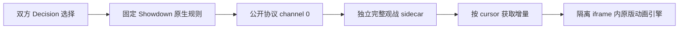
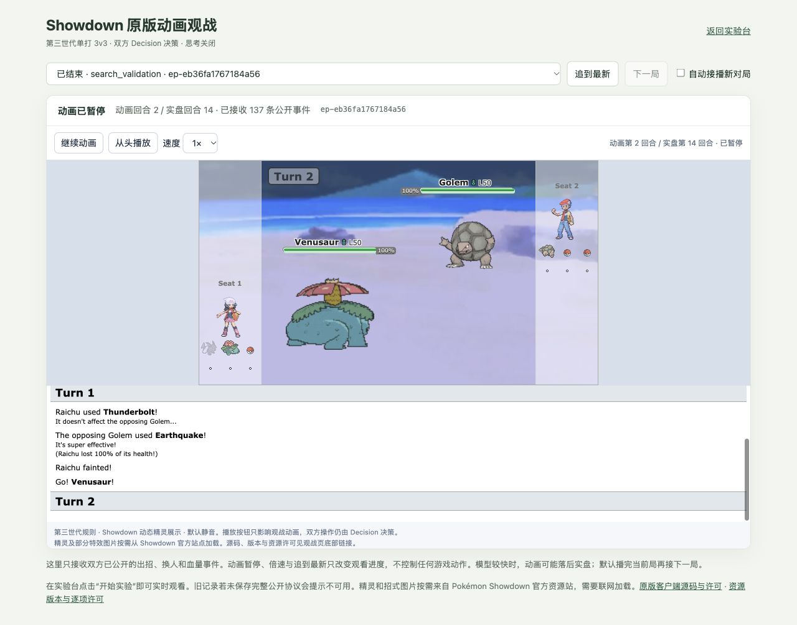

# Showdown 原版精灵动画观战 v1

2026-10-17：已接入 Pokémon Showdown 官方客户端的 Battle / Scene 动画渲染器。现在可以在浏览器看到双方出招、换人、HP 变化、状态异常和倒下动画。双方操作仍全部由 Decision 选择，`think_mode=never`；观战播放速度与游戏决策分离。

## 怎么看实盘

本机入口：[宝可梦实验台](http://127.0.0.1:18767/) → **原版动画观战**，也可以直接打开 [观战页](http://127.0.0.1:18767/spectate)。在实验台点击“开始实验”，观战页自动接收新对局。

- **暂停动画 / 继续动画**：只改变观看进度，Decision 对局继续运行。
- **1× / 2× / 4×**：改变招式动画播放速度，不改变模型推理或原生规则时间。
- **从头播放**：回放当前局已保存的完整公开记录。
- **追到最新**：切换到最新一局，并跳到已收到的最新战况；这是主动跳过动画。
- **自动接播新对局**：默认开启。必须收到最终事件且原版引擎确认动画播完，才进入下一局。训练和选优局也可观看。
- **对局下拉菜单**：选择已保存的某一局，手动选择后暂停自动接播。

模型可能在数秒内完成一场对局，而招式动画播放更慢。页面同时显示“动画回合 / 实盘回合”，这种延迟不会丢失招式。首次打开默认选择最新局，从头播放已发生事件；想马上看到当前状态，点击“追到最新”。

界面使用动态精灵表现，底层仍是第三世代单打 3v3。未接入公开匹配服，不需要 Showdown 账号。精灵和部分特效图片直接从官方资源站加载，需要联网；战斗日志与规则运行在本地。

## 安装与启动

依赖 Git、npm、curl、Node.js 22.18+，以及项目 Python 环境。仓库根目录执行：

```bash
bash scripts/setup_pokemon.sh
.venv/bin/python scripts/setup_showdown_viewer.py
.venv/bin/python scripts/run_pokemon.py serve \
  --data-dir data/experiments/pokemon-v1 --port 18767
```

已运行同端口服务时，不要重复启动。部署在其他端口时，观战地址为同一服务下的 `/spectate`。安装脚本固定客户端提交 `74056bbbb55d6ce15f9dd254186b94a51fe94b14`，并复用固定版本的本地 Showdown 模拟器。不同版本或已修改的上游源码会被拒绝，不覆盖用户修改。

原版资源构建至忽略目录 `.runtime/showdown-viewer/`。`manifest.json` 逐项记录源码、许可、SHA256 与 MIME，服务器只提供清单内且哈希一致的文件。客户端整体、独立动画引擎、CSS 和图像许可不同，见 [第三方说明](../THIRD_PARTY_NOTICES.md)；本项目不把整个组件统一标成 MIT。

## 数据链路与保存位置



完整公开记录保存为：

```text
data/experiments/pokemon-v1/spectators/<episode_id>.json
```

包含初始化、全部公开战斗行、进度与真实结束状态；不依赖模型输入里的最后 12 条 `recent_events` 拼接。游标按原生行数推进，重复内容也保留。刷新、断线重连和中途加入都能从任意游标补齐。切局时丢弃旧局的在途请求，自动切局还要求渲染器确认已经消费最终游标并播完动画。

旧对局没有完整 sidecar 时明确显示不可用，保留原有状态棋盘回放。预算截断只展示已经发生的事件，不伪造获胜或平局。记录失败也不会改变 Decision 动作或把对局计为失败。

职责拆分：

| 文件 | 职责 |
|---|---|
| `games/pokemon.py` | 单独保留完整 channel-0 协议，提供 `spectator_events()` |
| `runtime.py` | 可选只读观察回调；异常仅停用观战记录，不改变策略或执行 |
| `spectator.py` / `service.py` | 原子保存、生命周期、游标读取与历史索引 |
| `showdown_assets.py` / `app.py` | 固定资源、只读 HTTP 接口和观战入口 |
| `static/spectate.js` | 拉取增量、选择对局、动画队列与接播 |
| `static/showdown-frame.html/.js` | 原版 Battle 渲染器与纯播放控制 |

完整观战协议不会加入 Decision 的 snapshot、state 或策略。双方私有 request、未公开队伍、种子、待执行选择和回执不提供给动画组件。iframe 仅允许脚本，不允许同源权限；CSP 禁止连接请求和表单提交。父页面只处理绑定 iframe 的消息，播放组件没有选招接口。模型输入、全部合法动作集合、计分与进化标准沿用原来的实现。

## 真实验收

从浏览器点击一次“开始实验”，完成 1 局正式游玩及其局后 GEPA 流程产生的 3 局搜索对战。原始证据仍在本地 `data/experiments/pokemon-v1/`，这次新增的 4 局如下：

| 对局 | 用途 | Decision 次数 | 原生回合 | 公开协议行 | 候选方结果 |
|---|---|---:|---:|---:|---|
| `ep-e58edfe088854efe` | 正式游玩 | 13 | 5 | 59 | 胜 / 100 |
| `ep-eb36fa1767184a56` | 搜索选优 | 32 | 14 | 137 | 负 / 0 |
| `ep-b3801847c5e344ba` | 初版搜索训练 | 13 | 5 | 59 | 胜 / 100 |
| `ep-f5f7fc3236ba4911` | 候选搜索训练 | 17 | 7 | 76 | 胜 / 100 |

**75/75 次真实 Decision 回执明确报告思考未使用、推理 token 为 0。** 独立原生重放核对动作、完整合法目录、冻结双方策略、状态与真实胜负；再逐行比较完整观战协议，**331/331 行完全一致**，没有删掉或归并相同事件，也没有需要排除的时间戳行。

协议包含 49 次实际出招、43 次伤害与 6 次回复、15 次局内换人、17 次倒下。另有 8 次开场出场。Decision 提交数与实际出招数不同：某只精灵先被击倒时，其已提交招式可能没有执行；换人也是一次 Decision 选择。

浏览器确认动态精灵、招式日志、扣血和换人正常；暂停、继续、4× 播放、顺序自动接播、历史选择、刷新后完整回放均可用，检查时 console error 为 0。播放走到最后一局后显示“本局播放完成”，没有在旧动画结束前切走。截图是实际对局的动画回放，不是合成演示。



测试：完整既有范围检查 **857 项及 9 个 subtest 通过**；随后新增切局与资源路由回归，再运行观战相关四个测试文件，**84 项通过**。两批计数有重叠，不能相加。完整检查不包含工作区独立开发的三个王者荣耀测试文件。观察回调收集、抛错或修改传入副本时，测试确认 Decision 输入、动作目录、动作与最终状态和无观察回调时一致。

清理后的 [独立审计报告](experiments/pokemon-showdown-viewer-v1/audit.json) 可随仓库保存。普通网页模式保留原始响应回执，但没有记录完整实际出站 HTTP JSON；本次验证请求构造和回执绑定，不声称逐字节验证了出站请求。服务返回的模型名称也不等于验证了远端权重。

这四局用于验证观战链路，不是策略提升对照。用途和场景不同，且正式局与初版训练局重复同一开局，不能把 3 胜 1 负当作独立胜率。GEPA 沿用现有流程；本次没有证明能力提升，也没有批准新的 Harness。首版模型与策略限制仍见 [poke-env 接入实验](pokemon-integration-v1.md)。
