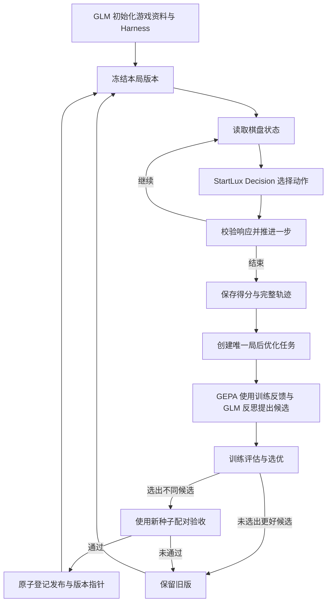

# Game Harness Lab：首版实现总结

日期：2026-10-17。当前交付是能够运行、记录和局后优化的贪吃蛇实验系统，已经接入真实 StartLux Decision、GLM-5.3 与 GEPA。

## 目标与本次范围

长期目标是建立可接入不同游戏的自动游玩与 Harness 持续改进底座，从贪吃蛇开始，再扩展俄罗斯方块、超级马里奥及实时、多角色游戏。

首版遵守一个核心约束：**游戏过程中的每个动作都由 StartLux Decision 选择；LLM 负责开局前准备和局后优化。** 先采用可暂停的游戏环境，避免把实时控制延迟与策略能力混在一起评估。

目前完成的是贪吃蛇完整闭环。多游戏统一适配器、Jev、读屏、桌面按键、模型权重训练和实时对战尚未实现。

## 已经实现的能力

| 能力 | 当前实现 |
| --- | --- |
| 游戏环境 | 自写固定规则的贪吃蛇；棋盘、随机种子、步数预算可设置；每吃一个食物得 1 分 |
| 唯一玩家 | 本地 StartLux Decision typed API；每次显式 `think_mode=never`，保存原始响应和思考遥测 |
| 游戏初始化 | GLM-5.3 生成背景、目标、规则、注意事项、攻略与初版 Harness；结构不合格最多修复一次 |
| 局后优化 | 每个正式回合建立一个持久化 GEPA 作业；训练、反思、选优、候选评测串行进行 |
| 优化对象 | 只修改 `decision_instructions` 和 `strategy_notes` 两段文字，不改游戏引擎、动作目录或计分器 |
| 发布与回滚 | 新旧版本在相同新种子上配对验收；通过才在下一局切换；可以回滚已批准版本 |
| 实验台 | 本地网页展示棋盘、得分、版本、作业和日志，提供暂停、继续、停止与历史轨迹回放 |
| 持久化与恢复 | SQLite 注册表、JSON/JSONL 轨迹、候选血缘、优化 attempt；重启补偿完整回合与遗漏任务 |
| 凭据与进程 | 密钥放本地 `.env`；HTTP 仅监听回环地址；启动文件锁阻止重复服务写同一份数据 |

每步始终向模型提供上下左右四个动作，包括危险动作。执行器只应用返回选择，不通过安全动作过滤、自动寻路或备用玩家替模型纠错。服务故障会中止，而不是伪装为一次策略零分。

## 实际运行流程

评测局属于当前优化任务，不继续递归创建优化任务。游戏使用一个固定版本完成整局，新版本只能在下一局生效。

## 从开源项目吸收的设计

- **GEPA**：直接使用真实 `gepa.optimize`，自写游戏 Adapter 和文本 proposer，承担候选搜索与选优。固定源码 commit 和依赖版本，便于复核。
- **JevHarness**：参考“LLM 教练、决策模型玩家、轨迹反馈”分工，没有复制许可证不明确的实现，也没有让生成代码直接选动作。
- **Continual Harness**：借鉴持续积累反馈与更新策略的思路，首版将更新限定在局后。
- **Voyager / OpenEvolve**：借鉴策略资产、候选血缘、分级评测与检查点思路；首版没有加入可自行决策的技能代码，也没有叠加第二个进化引擎。

具体源码研究与引用见 [GEPA / JevHarness](research-gepa-jev.md)、[其他进化框架](research-patterns.md) 和 [游戏环境](research-games.md)。

## 真实联调结果

首轮验收共完成 **31 个游戏回合、959 个动作**，其中正式游玩 2 局，其他 29 局用于训练、选优和发布验收。

- 所有执行动作都与保存的 StartLux 原始响应一致，返回模型为 `startlux-decision-27b-autothink`。
- 全部动作均报告思考未使用、思考 token 为 0；模型服务的全局默认配置未被改变。
- 重放保存的动作后，前后棋盘、得分和结束状态与原始记录一致。
- 第一次 GEPA 反思未选出更优候选，正确保留旧版。
- 第二次候选通过 4 对新场景验收：原版平均 **3.75 分**，候选平均 **4.75 分**，每对均未退步，已成为下一局活动版本。
- 玩家请求平均耗时 **81.15 ms**，P95 **91.374 ms**；这是本次串行实验测量，不是吞吐量保证。
- **76 个自动测试、9 个子测试通过**；真实 API 暂停/继续检查通过，前端 JavaScript 与 DOM 静态检查通过。

发布要求为至少 4 对场景、平均增加至少 0.5 分、每对不退步。这是首版经验门槛，4 对结果不能证明统计显著、长期稳定或跨游戏泛化；每轮可以没有提升。

完整种子、作业编号、配对结果和复核步骤见 [实测记录](validation-v1.md)。

## 当前限制与后续顺序

1. **先补用户界面实际验收。** 本次浏览器权限门禁拒绝打开页面；没有绕过限制。因此已验证后端与接口，视觉布局和浏览器点击/回放仍需实际检查。
2. **扩大蛇的评测。** 本次只验证了 2 局正式游玩，路线图中的连续 10 局验收与封存泛化评测尚未完成。增加固定场景、多次重复、置信区间与封存测试，观察改进是否稳定；当前同种子仍可能因模型输出波动产生不同成绩。
3. **改善反思反馈。** 当前用前 2 步和后 8 步的有界轨迹样本；后续加入食物事件、危险局面与关键失败窗口。
4. **抽取正式游戏适配器。** 先将蛇验证过的观察、动作、时钟、结束与计分接口固定，再接俄罗斯方块和马里奥。
5. **最后扩展实时、多角色。** 增加动作持续时间、请求截止时间、观测过期处理、并发调度与团队状态；目前不宣称已经支持王者荣耀。

其他边界：模型身份只核验服务返回名称；GEPA 中断后使用新 attempt 重试，不是逐迭代恢复；进程强杀造成的未完成回合 JSONL 保留审计，但不自动续玩。

## 文件、启动与版本管理

- 实现入口：[README](../README.md)、[详细实现](implementation-v1.md)。
- 源码：`src/game_harness/`；测试：`tests/`；记录复核：`scripts/audit_saved_run.py`。
- 长期设计：`architecture.md`、`roadmap.md`、`contracts/`、`examples/`；这些包含尚未实现的提案。
- 本地启动：在项目目录运行 `./setup.sh`，配置 `.env` 后运行 `./run.sh`，访问 `http://127.0.0.1:18765`。
- 测试命令：`.venv/bin/python -m pytest -q`。
- Git 保存源码、文档、测试、依赖锁定文件及无密钥的 `.env.example`。`.env`、`.venv/`、`data/`、缓存与构建产物不提交；本地模型和已有服务也不属于仓库。
- GitHub 仓库采用私有可见性；云端代码不包含已生成的本地实验数据库和原始轨迹。文档中的实测汇总随代码保留，完整原始记录继续保存在本机 `data/`。
