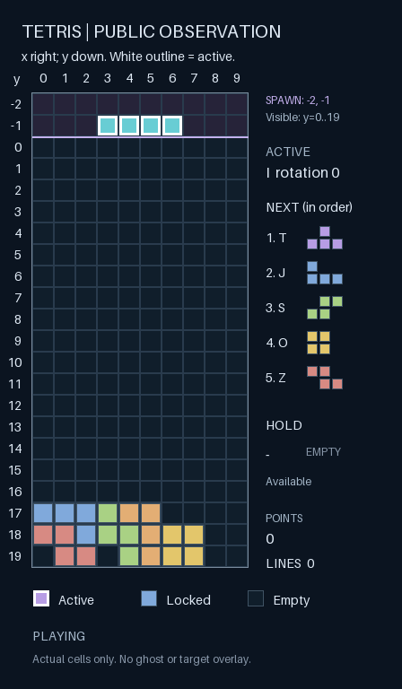

# V8：条件落点后果与独立目标规划

日期：2026-10-18。实验编号：`tetris-landing-v8-20261018`。本文件记录实现、冻结方案与真实对照结果。

**12 对正式实验中，新方案均分从 0 提升到 708.33，12/12 局消行，共 77 行。** 仍由 Decision 选择每个目标与按键，关闭思考。两组都使用视觉，本轮比较的是独立目标提示＋条件落点后果组成的规划方案。

## 本地实时体验

想直观看前后差异，可运行 `.venv/bin/python -m game_harness.tetris_comparison --port 18769`，打开 <http://127.0.0.1:18769/>。同一模型、相同种子与预算的两块棋盘并排运行，点击一次即可开始；操作与证据说明见 [实时对照页](tetris-comparison-experience-v8.md)。

运行 `.venv/bin/python -m game_harness.tetris_experience --port 18768`，打开 <http://127.0.0.1:18768/>。点击“开始 Decision 对局”即可看冻结 V8 Harness 实时操作，支持暂停、继续、停止和换种子重开。默认 80 次动作；增加上限属于新的体验条件，不属于上表的正式对照结果。

体验页每次目标和按键请求都使用当前棋盘图片，显式关闭思考。模型等待时游戏暂停；画面按每个已执行动作更新。数据、完整请求、回执和 PNG 独立保存到 `data/experiences/tetris-v8/`，不写生产版本、不运行局后 GEPA，也不修改冻结实验的证据。普通实验台仍在原端口运行。

## 借鉴了什么

本轮参考 [thelau/jev-tetris](https://github.com/thelau/jev-tetris/tree/9869b602965cf002afff766013f8c068846d36aa)（MIT）和 [pedroarruda07/jev-plays-tetris](https://github.com/pedroarruda07/jev-plays-tetris/tree/0d66fbc68c5cc075e750b2528d45f5371070989d)。核查的是固定版本源码，没有安装运行它们，也不将项目方成绩当成本地复现结果。

thelau 的长处是把各落点后果写成一致的描述，让 Jev 比较。其静态搜索使用简化踢墙，不含我们的原生重力、锁定计时和按键持续时间；它还用人工权重合并五个问题的概率，直接应用选中落点。其三个种子也参与了调参。[后果描述与概率合成](https://github.com/thelau/jev-tetris/blob/9869b602965cf002afff766013f8c068846d36aa/src/describe.js)、[作者的实验限制](https://github.com/thelau/jev-tetris/blob/9869b602965cf002afff766013f8c068846d36aa/docs/findings.md)。

pedro 将目标规划与按键执行分开，并检查目标与当前方块的关联。不过，它会在候选过多时启发式裁剪，并由控制器自动执行路径。未找到明确许可证，本轮只借鉴设计，不复制源码。[落点搜索](https://github.com/pedroarruda07/jev-plays-tetris/blob/0d66fbc68c5cc075e750b2528d45f5371070989d/src/placements.ts)、[执行器](https://github.com/pedroarruda07/jev-plays-tetris/blob/0d66fbc68c5cc075e750b2528d45f5371070989d/src/jev/execution.ts)。

本项目采用完整、对称的落点后果描述和独立目标提示。每个目标、每次原生按键及持续时间仍由 Decision 的原始 `choice` 决定，`think_mode=never`；不合并概率、不按算法得分挑目标、不执行自动路径、不使用失败兜底。

## 条件预测的准确边界

`tetris-context-v3` 是显式启用的实验配置。v1/v2 保持原请求语义及回放兼容，原生规则和执行 bridge 未修改。

`tetris_landing_projections` 从公开棋盘和当前方块计算完整 40 项列×朝向组合，另有 keep/clear，共 42 个目标 ID，顺序不变。每项假设当前方块先到达目标朝向和最左占用列，保持当前局部框原点 y，再沿竖直方向硬降。字段包括落点四格、消行数、原生积分变化、空洞前后与净变化、最高列、总列高、相邻列高度差绝对值之和及隐藏行占用。

这些是**条件几何后果，不是原生按键可达证明**。没有模拟到达姿态所需的旋转路径、SRS 踢墙、横移、耗时、途中重力或 hold。`native_reachability` 始终为 `not_proven`。越界或假设起始姿态碰撞时保留该选项，用 `invalid_reason` 与 null 预测值标明，不能把未知当作零空洞。

计算包含两行生成区，消行积分用消行前等级；`holes_delta` 是净变化，不冒充新建空洞数量；`top_out` 只表示锁块消行后的隐藏行占用，false 不保证下一块生成成功。每个目标的 Choice 描述附同样口径的结果，不排序、不删除、不提供综合分或推荐标签。动作选择仍收到完整原生目录。

落点测试与未修改的原生引擎对照：39 个构造状态×40 目标，共 1,560 项，覆盖七种方块、四朝向、边界、低位旋转越界、起始碰撞、隐藏行、一至四行消除、等级计分和 TOP_OUT。对照只验证假设姿态后的直落结果，不把构造状态测试当作模型游戏成绩。

下面是实际发给模型的一帧，固定选自首局工程校准中“首次存在条件消行选项”的目标调用（step=17）。同时发送的 `target:6:0` 描述为：假设到达后消一行、原生积分 +100、空洞 2→2、最高列 2。Decision 自己选了这个目标，随后分别选 `right:1000` 和 `hard-drop:100`，原生游戏在 step=18 消一行、增加 100 分。两次按键各有独立模型回执，宿主没有自动执行路径。这是工程示例，不计入正式成绩。[完整对应请求与图像哈希](experiments/tetris-landing-v8/decision-input.json)。



## GLM 如何生成这版 Harness

`initialize_tetris_landing_planner.py` 只读取固定的 V7 失败局 `vision/evaluation-00`，节选前六步与最后四步，先离线验证 16 个动作和 13 次目标调用。GLM-5.3 收到旧动作策略、真实规则、后果字段合同、固定版本研究结论和这些历史轨迹；没有收到 V8 新对局结果。

真实调用一次即返回有效 JSON，原样接受目标提示，无人工改写。用时 9.60 秒，服务报告输入 26,808 tokens、输出 379 tokens。完整输入、HTTP 请求 JSON、响应、来源哈希与调用记录保存在本机实验目录，认证 header 不归档。

[目标提示与生成血缘](experiments/tetris-landing-v8/planner.json)、[完整研究 Harness](experiments/tetris-landing-v8/research-harness.json)、[教练调用记录](experiments/tetris-landing-v8/coach-generation.json)已保存。公开 planner 删除了本机来源路径，因此整个文件哈希不同；目标提示原文及其哈希、模型调用和来源内容哈希保持一致。

新提示先复核已有目标，再比较消行、空洞净变化、堆高和空间，避免用固定列偏好替代后果比较。旧的按键策略原文保留。目标提示只用于目标调用，不再把长篇按键操作提示一起传给目标规划。

研究 Harness 中的旧 `brief` 与原 `provenance` 也保持不变，以保留父版本资料和血缘。其中“没有落点预测／四组共用”等旧说明不描述 V8 的新增输入；运行器不会把 `brief` 直接传给玩家，实际输入以 v3 配置、接口合同和归档请求为准。V8 新增目标提示的生成血缘见 `planner.json`，不要把旧 V7/V6 来源字段误读成整份研究配置仍是旧版。

这是一次由 LLM 生成并冻结的研究候选，不是新一轮 GEPA 种群搜索，也没有在对局中改模型权重。Prompt 的质量仍由对照结果检验。

目前该目标提示由独立初始化器生成；通用 GEPA 仍优化原来的两个文本组件，尚未自动搜索这个新增的 `goal_instructions` 字段。验证规划输入有效后，才适合将它作为独立可进化组件，并保留新的独立验收集。

## 冻结方案

| 项目 | baseline | planning |
|---|---|---|
| 模型与思考 | StartLux Decision，never | 相同 |
| 视觉 | 每次目标和按键请求附当前棋盘 PNG | 相同 |
| 动作策略 | V6 GLM 修订版原文 | 相同 |
| 目标 ID 和顺序 | 完整 42 项 | 相同 |
| 目标提示 | 旧动作提示附目标更新说明 | 独立 GLM 目标提示 |
| 条件落点后果 | 无 | 完整 40 项事实＋对称目标描述 |
| 执行 | 每个原生按键由 Decision 选择 | 相同 |

固定 2 对工程校准＋12 对新种子正式实验，共 28 局。每局最多 80 次原生动作；模型等待时游戏时钟暂停。配对共享模型可见 episode ID，交替运行顺序，排除已登记的历史种子。策略、源码快照、模型名称、依赖、种子与预算在运行前冻结。

[完整冻结方案与种子列表](experiments/tetris-landing-v8/protocol.json)。

主指标为 planning 减 baseline 的原生平均积分，按种子配对 bootstrap 10,000 次，95% 区间。辅助指标是消行局比例、总行数、堆顶、控制行为和调用成本。小样本筛查不代替独立发布验收；不自动修改生产注册表或导出为已批准 Harness。

校准只验证工程链路，不用于改提示、挑种子或按分数停止。正式实验不按成绩增减样本。基础设施失败保留证据，不记零分；代码或审计合同错误必须修复并重新冻结批次，不能用 `--retry-failed` 掩盖。两项规划修改一并测试，因此无法独立归因于提示拆分或后果描述。

## 结果与审计

**本轮取得了明显的得分和消行提升。** 正式 12 对中，planning 每对都高于 baseline，平均增益 +708.33 分，95% 配对 bootstrap 区间 [+591.67, +825.00]，通过预先设定的研究筛查标准。

| 正式指标，每组 12 局 | 旧视觉 Harness | 独立目标提示＋条件落点后果 |
|---|---:|---:|
| 原生平均分 | 0 | **708.33** |
| 总积分 | 0 | 8,500 |
| 成功消行局数 | 0/12 | **12/12** |
| 总消行数 | 0 | **77** |
| TOP_OUT | 7/12 | **0/12** |
| 达到 80 步上限 | 5/12 | 12/12 |
| 实际按键数 | 536 | 960 |
| 目标选择次数 | 230 | 349 |

| 配对 | 环境种子 | 旧积分 | 新积分 | 旧消行 | 新消行 |
|---|---:|---:|---:|---:|---:|
| evaluation-00 | 1921416371 | 0 | 600 | 0 | 6 |
| evaluation-01 | 2131984239 | 0 | 500 | 0 | 5 |
| evaluation-02 | 1138396099 | 0 | 900 | 0 | 8 |
| evaluation-03 | 1955404617 | 0 | 700 | 0 | 7 |
| evaluation-04 | 426372397 | 0 | 400 | 0 | 4 |
| evaluation-05 | 1341939319 | 0 | 900 | 0 | 8 |
| evaluation-06 | 1847563232 | 0 | 1000 | 0 | 9 |
| evaluation-07 | 636008749 | 0 | 500 | 0 | 4 |
| evaluation-08 | 134419829 | 0 | 700 | 0 | 7 |
| evaluation-09 | 1137254864 | 0 | 500 | 0 | 4 |
| evaluation-10 | 1402630552 | 0 | 800 | 0 | 7 |
| evaluation-11 | 211039554 | 0 | 1000 | 0 | 8 |

新方案得分范围 400–1,000；没有负增益或同分对。工程校准的两对另外报告：旧方案 0、0 分，新方案 800、700 分（各 7 行），**不混入上述正式结果**。[全部配对成绩、统计和分阶段成本](experiments/tetris-landing-v8/results.json)。

该结论限于本模型、这套原生规则、12 个新种子及每局 80 按键窗口，不能解释成长局成功率始终 100%。正式样本全部二元差相同时，“有无消行”非参数 bootstrap 区间会退化为 [+1,+1]；不能把它当作长期成功概率保证。本轮以存在波动的原生积分及其配对区间为主指标。

两组均有视觉，故这次证明的是规划输入组合的效果，不能证明图片必要，也不能拆分独立提示与后果描述各自的贡献。无需更新模型权重，就能通过 Harness 大幅改善本批游戏表现；这与此前“只追加图片仍不消行”的结果不同。

### 行为诊断

事后分析仅使用正式 24 局，先通过全批审计，再按预先写定的诊断规则重建每步条件投影。baseline 的投影只在事后计算，没有送给旧模型。

| 行为指标 | 旧方案 | 新方案 |
|---|---:|---:|
| 显式新目标的条件姿态无效 | 45/201（均为横向越界） | **0/309** |
| 在条件姿态无效的目标下行动 | 281/536 | **0/960** |
| 显式新目标重复选择列 3、朝向 0 | 95/201（47.26%） | 18/309（5.83%） |
| 存在条件消行选项时，目标调用选择该类选项 | 0/4 | **100/100** |
| 硬降前已到达自己选定的列与朝向 | 156/157 | **272/272** |
| 硬降实际发生消行 | 0/157 | **69/272** |
| noop 次数 | 101 | 0 |

这组记录支持“目标选择得到改善”的解释：旧方案多数硬降也能到达自己的目标，但目标本身不产生消行；新方案把更合理的目标交给同一套按键策略，真正完成了 77 行消除。虽然旧动作策略原文没有改，新增事实和接口合同也进入了动作请求，因此不能声称执行层完全没有受到输入变化影响。

条件消行不等于路径可达；上述分母包含重复调用和不同的实际棋盘，不能当作独立样本，不能用 100/100 推断泛化成功率。空洞、高度等只用于解释行为，没有替换原生得分或触发程序代选。

按固定规则选出的首个正增益案例是 `evaluation-00`：旧方案 52 步堆顶、0 分，新方案 80 步得到 600 分、消 6 行。完整案例保留每次真实锁块、原始动作前坐标、目标、条件后果和终局棋盘。本批没有负增益或“同分且新方案堆顶”的案例，对应类别保持为空，不换成更好看的例子。[完整行为诊断与案例](experiments/tetris-landing-v8/goal-diagnostics.json)。

最终离线审计重放 **28 局**，逐份重建 **2,343 次请求与回执、2,343 次图像绑定以及 1,406 张去重 PNG 原字节**；目标记忆、40 项条件后果、Choice 描述、关闭思考遥测、原生动作与积分全部通过。没有未完成尝试或未进入完成局的请求。[完整审计报告](experiments/tetris-landing-v8/diagnostics.json)。


### 成本、测试和保存

正式游戏共 2,075 次 Decision 调用：1,496 次按键＋579 次目标选择。工程校准另有 268 次。全批 **28 局、2,343 次请求**，没有失败、重试或遗漏响应；另有一次离线 GLM 初始化。协议 `coach_calls=0` 指冻结后的游戏阶段，不包括这次初始化。

| 正式调用成本 | 旧方案 | 新方案 |
|---|---:|---:|
| 请求数 | 766 | 1,309 |
| 动作平均延迟 | 481.1 ms | 937.1 ms |
| 目标平均延迟 | 833.5 ms | 1,570.1 ms |
| 累计模型等待 | 449.57 s | 1,447.61 s |
| 服务报告输入 tokens | 10,410,749 | 34,416,108 |
| 输出 tokens | 0 | 0 |

提升伴随更大的请求和更高延迟；新方案也因为都运行满 80 步而调用更多。两组分岔后棋盘与目标调用频率不同，上表不能单独估计某个字段的成本。模型等待期间物理时钟暂停，所以推理更慢不会让方块额外下落；尚未验证不停表实时模式。没有价格字段，未推算现金费用。

相关测试累计 **992 项＋9 个 subtests 通过**（冻结前全套 983 项，新增事后分析 9 项）；另一个王者接入任务的三份测试未混入。当前生产注册表和 `harnesses/` 已批准包均保持原样。[保存边界核验](experiments/tetris-landing-v8/production-verification.json)。研究筛查通过后仍未自动发布，本轮的可复用产物保存在 `docs/experiments/tetris-landing-v8/research-harness.json`。


## 复现

```sh
uv pip install --python .venv/bin/python '.[vision]'

# 可选：根据固定历史轨迹生成新的目标提示；需要本机 V7 原始实验目录。
.venv/bin/python scripts/initialize_tetris_landing_planner.py \
  --output data/experiments/<新的提示目录>

# 复用本轮已冻结提示；若要测试新提示，将 --planner 换成上一步产物。
.venv/bin/python scripts/run_tetris_landing_experiment.py prepare \
  --id <新的实验编号> \
  --parent docs/experiments/tetris-vision-v7/research-harness.json \
  --planner docs/experiments/tetris-landing-v8/planner.json
.venv/bin/python scripts/run_tetris_landing_experiment.py run-calibration --id <新的实验编号>
.venv/bin/python scripts/run_tetris_landing_experiment.py run-evaluation --id <新的实验编号>
.venv/bin/python scripts/report_tetris_landing_experiment.py data/experiments/<新的实验编号>
.venv/bin/python scripts/analyze_tetris_landing_goals.py data/experiments/<新的实验编号>
```

原始数据位于 `data/experiments/tetris-landing-v8-20261018/`，提示生成记录位于 `data/experiments/tetris-landing-v8-planner-20261018/`，均被 Git 忽略。公开文档保存脱敏方案、完整配对成绩与研究 Harness。研究配置不会自动进入网页常规运行。

源码变动后，历史实验应使用各自 `source_snapshot/scripts/` 中的报告入口核验，不放宽源码哈希检查。服务只报告模型名称，没有可核验权重哈希；仍不能排除服务内部版本变化和推理非确定性。
