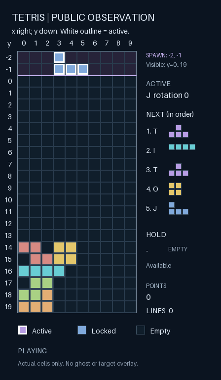

# V7：俄罗斯方块视觉输入对照实验

日期：2026-10-18。实验编号：`tetris-vision-v7-20261018`。

**视觉通道已接通，但本轮没有提高得分或消行稳定性。** 同一套 Harness 的 24 对真实游戏中，文字组均分 20.83、3/24 局消行；加图组均分 4.17、1/24 局消行，TOP_OUT 从 9/24 增至 20/24。配对平均增益 −16.67 分，95% bootstrap 区间 [−45.83, 0]。本批观测表现更差，区间仍包含 0；小样本既不支持“明显提升”，也不能据此断言所有视觉方案都会退化。实验版本未替换生产 Harness。

## 视觉输入实现

`VisionDecisionProvider` 复用原有 Decision 请求构建和回执验证，只给视觉组增加顶层 `images` 数组，其中是 PNG 的 data URI。这个字段来自 [StartLux 官方 API 合同](https://github.com/StartLuxLabs/StartLux-Decision/blob/main/docs/api.md)，不是把图片路径作为文字传给模型。

图片是当前原生公开观察的确定性渲染，分辨率 448×768：10 列、20 行可见棋盘与上方两行生成区，当前方块的实际格子和朝向、五块公开预览、暂存、原生积分。白色边框区分活动方块。图像不包含隐藏随机状态、预览之外的未来队列、自动规划落点或算法建议，也不从网页截取额外信息。

下图是工程校准中真正发送给 Decision 的一帧；[请求对应关系与原图哈希](experiments/tetris-vision-v7/decision-input.json)一并保存。



每次目标选择和每次按键选择都附带图片。目标仍由 Decision 自己写入记忆；原生按键及持续时间也全部由 Decision 选择。没有本地规划器、自动纠正目标、过滤候选、自动硬降或 API 失败后的随机兜底。图片生成只是观察编码，不更新模型权重。

每个请求显式 `think_mode=never`。接收时要求 `thought.used=false`、整数 reasoning tokens=0，并拒绝 output tokens、思考计时、after_thought 等可用字段与关闭思考声明相矛盾的响应。

图片按 SHA256 保存一次；每个目标/动作请求记录其图片哈希、原始 JSON 和实际 HTTP 序列化字节哈希。离线报告会从该步观察重新画图，验证 PNG 原字节，再重建实际请求、原始响应、目标记忆和原生规则执行结果。认证只进 HTTP header，不进入模型状态、图片或归档。

## 先确认模型真的使用图片

工程预检保持文字、问题和选项完全相同，只把图片里的红块交换到左边或右边，顺序为左、右、右、左。真实 Decision 四次全部识别正确，回执均关闭思考。用时约 31.7–80.2ms，每次输入 295 tokens、输出 0 tokens。[预检记录](experiments/tetris-vision-v7/image-channel-preflight.json)。

这证明当前服务能接受并利用图像，不证明模型已理解复杂棋盘，也不算游戏成绩。游戏阶段仍必须通过原生对局检验。

## 冻结对照方案

- A：V6 已评测的 GLM 修订策略＋结构化棋盘＋Decision 目标记忆＋控制反馈。
- B：与 A 完全相同，额外在每次目标和动作请求附加当前棋盘 PNG。
- 相同模型 `startlux-decision-27b-autothink`、游戏资料、策略原文、完整 42 个目标选项和原生动作目录；每局最多 80 次动作。模型等待时物理时钟暂停。
- 两组使用相同种子与相同模型可见 episode ID，交替先后顺序。重试编号只保存在磁盘路径和实验元信息里，不进入模型输入。
- 先跑 2 对、4 局工程校准，再跑 24 个新种子、48 局正式实验。排除既有记录中已用、失败和预留的种子。校准成绩不参与正式统计，也不用于改策略、挑种子或决定是否继续。
- 主比较：视觉减文字的原生平均分；按种子成对 bootstrap 10,000 次，95% 区间。辅助报告消行局比例、总消行数、TOP_OUT、控制行为及成本。正增益且区间下界大于 0 只是本轮描述性筛查标准，不是生产发布验收。
- 不按中途分数停止或追加样本。完成局不重抽；基础设施失败保留证据、不记零分，最多显式恢复一次。

本次完全保留 V6 策略中已知的目标可行性与条件冲突，没有同时让 LLM 重写打法，也没有新一轮 GEPA 搜索。这样才能把本批差异归因于增加图片这一实验因素。两组运行后状态会随动作分岔；“相同文字”指相同初态、规则和编码逻辑，不指分岔后仍发送同一张棋盘的文字。

## 结果

| 正式指标：每组 24 局 | 相同 Harness，只用文字 | 相同 Harness，加棋盘图片 |
|---|---:|---:|
| 原生平均分 | 20.83 | 4.17 |
| 成功消行局数 | 3/24（12.50%） | 1/24（4.17%） |
| 总消行数 | 4 | 1 |
| TOP_OUT | 9/24（37.50%） | 20/24（83.33%） |
| 游戏动作数 | 1,708 | 897 |
| 目标调用数 | 650 | 459 |
| 锁定方块数 | 398 | 395 |
| 每锁块动作数 | 4.29 | 2.27 |

24 对中，视觉组 **0 对得分更高、2 对更低、22 对持平**。两组仅在 `evaluation-02` 同时得 100 分；文字组另外在 `evaluation-18` 得 100 分、`evaluation-21` 一次消两行得 300 分，而对应视觉组为 0 分。原生两行同时消除计 300 分，因此积分不能直接按总行数乘 100。

主比较视觉减文字为 −16.67 分，95% 配对 bootstrap 区间 [−45.83, 0]；正增益且区间下界大于 0 的筛查标准未通过。成功消行比例差为 −8.33 个百分点，辅助区间 [−20.83, 0] 个百分点。工程校准四局两组均为 0 分，单独保留，没有混入正式结果。

“每锁块动作数更少”没有转化为更强的游戏能力：视觉组放下的方块总数接近文字组，却大多更早堆顶。图片能够影响输入和行为，并不自动保证落点规划正确。

[完整配对结果与分阶段成本](experiments/tetris-vision-v7/results.json)包含全部种子与零分局，不只展示成功案例。

## 为什么没有提升

完整 48 局的事后分析显示，几类空转行为发生率降低了，但落点质量仍未解决：

| 事后行为指标 | 文字 | 加图 |
|---|---:|---:|
| 明确横向越界目标下的动作／可检查动作 | 977/1,694（57.67%） | 222/885（25.08%） |
| 朝已接触边界横移但没有位移／横移动作 | 626/981（63.81%） | 126/407（30.96%） |
| noop／全部动作 | 317/1,708（18.56%） | 83/897（9.25%） |
| 显式新目标中选择“最左列 3、朝向 0” | 209/506（41.30%） | 217/423（51.30%） |

目标几何检查仅在当前朝向等于目标朝向时进行；用当前实际格子宽度证明目标越出棋盘，不做未来搜索。新目标比例排除了 keep；完整分布没有只保留中心列。上述分母包含重复动作，且两组经历的状态及结束时点不同，不能当作独立样本或视觉识别能力的因果证明。

**当前 Harness 两组都存在过度重复中部落点的行为，加图组中这一目标占比更高。** 对局执行仍可能准确对齐自己的目标，但目标本身会不断堆高，无法形成完整行。固定规则选出的案例：

- **首个“同分且视觉堆顶”对：evaluation-00。** 两组前期都反复选列 3、朝向 0。文字组 25 步堆顶；视觉组 16 步、13 次硬降，其中 12 次目标选择为 `target:3:0`，最终最高列达到 22 格。这个问题原本就在文字组里，不能说是图片凭空造成的。
- **首个负增益对：evaluation-18。** 文字组第 29 步将 O 块放到最左列 8，消一行得 100 分；视觉组未消行。两组都用满 80 次动作，仍有越界目标和空转。视觉组最终孔洞数反而较少（38 对 57）、最高列也较低（13 对 14），但原生得分为 0，说明仅改善“平整／少洞”等代理指标仍不足以证明消行能力。
- **正增益对为空。** 正式 24 对没有一对视觉得分超过文字，因此没有选择“视觉提高分数”的案例。

案例由冻结对局顺序中的首正、首负、首零且视觉堆顶选取，缺失类别留空；没有看完后换成更漂亮的故事。[完整几何统计、目标/动作分布及案例锁块轨迹](experiments/tetris-vision-v7/goal-diagnostics.json)。

现有证据支持的判断是：**图像传输和运行链路正常，但把图片直接追加到现有长 Harness，不足以修复目标规划。** 它不能证明模型完全看不懂棋盘，也不能排除提示词、视觉表达或目标选择方式的影响。目标规划与按键执行共用较长策略文字、且已有条件冲突，是值得优先验证的 Harness 问题；当前实验没有单独干预它，尚不能确定因果。

下一步先用独立开发棋盘检查 Decision 能否从图片识别最高列、当前方块宽度和洞的位置，答案由公开棋盘确定，区分“看不准”与“看到了但规划不好”。随后仅让 LLM 生成独立的目标规划提示，移出列差、按键时长等执行指令，明确按消行、造洞、堆高评估落点；保持图片、按键提示、完整目录和动作预算不变，所有目标和动作仍由 Decision 决策。

冻结新目标提示后，以新种子比较“旧视觉 Harness／只改目标提示的视觉 Harness”，继续以原生得分及配对区间为验收依据。若还需要区分提示修复与图片各自的作用，再做旧／新目标提示 × 无／有图片的四组对照。本轮没有执行这些后续策略修改。

## 调用成本与验收

正式 48 局共 2,605 次游戏动作＋1,109 次目标调用＝**3,714 次 Decision 请求**；工程校准为 203＋92＝295 次。全批 52 局共 **4,009 次请求**，无失败、无重试。另有 4 次独立图片位置预检，本轮合计 4,013 次真实 Decision 调用；没有新增 GLM 调用。

| 正式调用成本 | 文字 | 加图 |
|---|---:|---:|
| 动作＋目标请求数 | 2,358 | 1,356 |
| 动作平均延迟 | 440.4ms | 473.9ms |
| 目标平均延迟 | 795.2ms | 826.5ms |
| 累计模型等待 | 1,269.04s | 804.43s |
| 服务报告逻辑输入 tokens | 30,067,092 | 19,179,638 |
| 输出 tokens | 0 | 0 |

视觉组每次调用平均更慢，总调用和等待更少主要伴随更早失败，不能解释为更高效。两组分岔后的状态长度不同，上表不是纯图像 token 或纯图像计算开销的估计。服务没有独立 image_tokens 或现金费用字段，不推算不存在的报价。

全批实际首个目标请求也逐对比较过：26 对去掉 `images` 后 JSON 完全一致；之后的输入随着各自决策产生的状态和记忆变化而分岔。[实际初始输入对照](experiments/tetris-vision-v7/initial-input-comparison.json)。

最终审计重新播放全部 **52 局**，逐一核对 **4,009 份请求与回执**、**1,450 次带图请求**及其 **773 张去重原始 PNG**，全部通过；无遗漏或未完成尝试。[审计结果](experiments/tetris-vision-v7/diagnostics.json)。相关全量测试 **930 项＋9 个 subtests 通过**；未混入工作区另一个王者接入任务的三份测试。另模拟未安装 Pillow 的普通环境，视觉专项测试会跳过而不是阻断全套测试收集。

## 复现与保存

```sh
uv pip install --python .venv/bin/python '.[vision]'

# parent 必须是完整的 V6 运行 Harness（含 tetris_context_config）。
# 本批从旧 manifest.arms.repaired 精确导出；单独 repaired.json 不含全部运行配置。
.venv/bin/python scripts/run_tetris_vision_experiment.py prepare \
  --id <新的实验编号> \
  --parent docs/experiments/tetris-vision-v7/research-harness.json
.venv/bin/python scripts/run_tetris_vision_experiment.py run-calibration --id <新的实验编号>
.venv/bin/python scripts/run_tetris_vision_experiment.py run-evaluation --id <新的实验编号>
.venv/bin/python scripts/report_tetris_vision_experiment.py data/experiments/<新的实验编号>
```

每个新批次会重新排除已登记的历史种子，因此新的批次不应被当作精确复现原批成绩；原批可在不调用模型的情况下执行离线回放与审计。源码、原生引擎、Pillow 12.0.0 与 httpx 版本随 manifest 冻结，源码快照保存在原始目录。模型服务只报告名称，没有提供可核验的权重校验和；不能排除服务内部版本变动及推理非确定性。

[公开实验方案](experiments/tetris-vision-v7/protocol.json)保留种子、比较方法和预算。[可复用研究 Harness](experiments/tetris-vision-v7/research-harness.json)保留相同策略、游戏资料、模型和上下文配置，去除了历史本机路径和旧教练调用记录，因此整个文件的哈希与本机原始父版本不同；策略和资料哈希保持一致。它仅供实验，不是已批准导出包。

原始请求、响应、PNG、轨迹与冻结配置位于本机 `data/experiments/tetris-vision-v7-20261018/`，由 Git 忽略。公开文档保存脱敏统计与代表性输入图。研究运行器不改生产注册表、不自动导出为已批准 Harness；网页普通模式不会自动启用图片。
